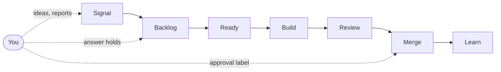

# agentic-sdlc

> **0.1 (early).** Interfaces may change before 1.0, and no full cycle has run yet on a real
> repository in a cloud routine. Try it on a sandbox repo first.

agentic-sdlc delivers a product for you with Claude Code agents, using your GitHub issues as the
board. A scheduled Claude cloud routine moves each issue one step at a time, from a signal to a
merged and shipped change, and CI checks that no agent can skip decide what merges. You answer the
few questions a rule reserves for a person, from your phone.

You put in ideas and reports, you answer holds (an issue labelled `needs-human` with one question),
and you approve Full-lane and factory pull requests with the `approved` label. The label counts from
an owner account, also when the factory acts as that same account: see
[Your part](docs/guide/3-your-part.md).

## Install

Once, on a computer with Claude Code and Node 22.18 or later:

1. **Add the plugin.** In Claude Code: `/plugin marketplace add dmitriywind/agentic-sdlc`, then
   `/plugin install agentic-sdlc@agentic-sdlc`.
2. **Run the setup skill.** Open your repo and ask Claude Code to set up the factory. It installs the
   files, fills the binding from your project, creates the labels and the heartbeat issue, checks
   until clean, and opens the install as a pull request.
3. **Do the checklist it prints:** merge the install pull request, install the Claude GitHub App on
   the repo, create the cloud routine with the cycle prompt and a schedule, and import the trunk
   ruleset.

The CLI ships from Git only. The npm package named `agentic-sdlc` is a different project.

## A day from the phone

- GitHub notifications show new asks. Reply in a comment; the next cycle picks the reply up.
- A pull request waits for you: read it in the GitHub app and add the `approved` label.
- A new idea or bug: open an issue with the **Signal** form. The next cycle triages it.
- Ask a Claude Code session on the repo what waits on you; the `setup` skill answers from
  `agentic-sdlc status`. Not yet tried from a phone.
- If the cycle goes quiet, the dead-man check files a Signal and GitHub tells you.

## What it costs

- **Claude:** your subscription only; no API key path. Routine runs draw the same usage as your
  interactive work and are refused at the usage limit. A routine runs at most once an hour, and
  routines are a research preview.
- **GitHub:** the gates run in GitHub Actions. Public repos are free. Private repos use the plan's
  included minutes (2,000 Linux minutes a month on Free); a self-hosted runner bills none.

## Read more

- [The guide](docs/guide/1-what-it-is.md), also as one page with interactive scenarios:
  [dmitriywind.github.io/agentic-sdlc](https://dmitriywind.github.io/agentic-sdlc/guide.html).
- [The contract](references/architecture.md): ports, verbs, binding keys, gates, the trust model.
- [The behaviour](features/), as executable features (`npm test`).
- [The binding template](templates/binding.yml) and [the runner templates](templates/runner/routine.md).
- [The roadmap](docs/roadmap.md), [contributing](CONTRIBUTING.md), [security](SECURITY.md).

This repo does not run its own factory: a broken factory gating its own repo could not be fixed
through itself.

## License

Apache-2.0
