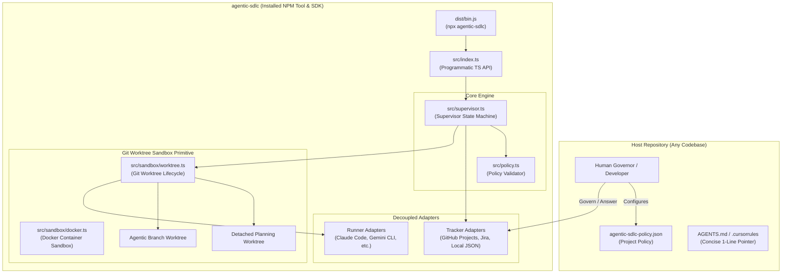
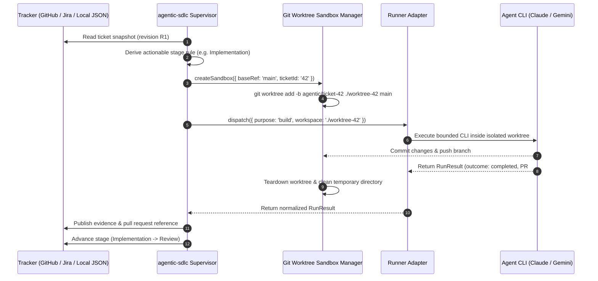

# agentic-sdlc

> Governed agentic software-delivery loop with Git worktree sandboxing, durable tracker truth, and TypeScript SDK & CLI.

---

## Overview

`agentic-sdlc` is an installable developer tool and TypeScript library (`agentic-sdlc`) designed to run AI coding agents (Claude Code, Gemini CLI, etc.) in a governed, reproducible delivery loop.

Unlike unconstrained agent setups that pollute your active working copy or run unattended without oversight, `agentic-sdlc`:
1. **Never touches human checkouts**: All planning runs in detached worktrees, and all implementation runs execute in isolated `agentic/ticket-*` branch worktrees.
2. **Durable Tracker Truth**: Work state, stage evidence, decisions, and escalations live in your tracker (GitHub Projects, Jira, or Local JSON), not in transient agent runtime memory.
3. **Strict Policy Governance**: State machine transitions are enforced by `agentic-sdlc-policy.json`, with explicit human approval gates (`waiting:decision`) and evidence validation.

---

## Features

- 🛠️ **CLI & Programmatic SDK**: Run via `npx agentic-sdlc` or embed in custom Node.js/TypeScript workflows via `import { createSupervisor } from 'agentic-sdlc'`.
- 🏰 **Git Worktree & Docker Isolation**: Automated git worktree creation, containerized Docker runner environments (`createDockerSandbox`), branch management, commit/push handling, and teardown.
- 📋 **Tracker Adapters**: Built-in support for GitHub Projects, Jira (REST API), and local JSON trackers.
- 🤖 **Multi-Model Routing**: Map semantic lanes (`triage`, `planning`, `execution`, `review`) to specialized model profiles with automatic fallback chains.
- 🎯 **Stage-Scoped Goal Mode**: Bounded continuations and retry safety nets.
- 🛡️ **Fail-Closed Security**: Protected paths validation prevents unauthorized edits to sensitive repository files.

---

## Installation

Add `agentic-sdlc` to your TypeScript or JavaScript repository:

```bash
npm install -D agentic-sdlc
# or
pnpm add -D agentic-sdlc
# or
yarn add -D agentic-sdlc
```

---

## Quickstart CLI Commands

### 1. Initialize Project Policy & Rules Pointer
Initialize `agentic-sdlc-policy.json` and inject the project rule pointer into `AGENTS.md` / `.cursorrules`:

```bash
npx agentic-sdlc init
```

### 2. Validate Policy Configuration
Check your policy file against normative specification rules:

```bash
npx agentic-sdlc validate
```

### 3. Run Supervisor Loop
- **Single Read-Only Dry Run**:
  ```bash
  npx agentic-sdlc supervise --once --read-only
  ```
- **Single Mutating Tick**:
  ```bash
  npx agentic-sdlc supervise --once
  ```
- **Continuous Daemon Mode**:
  ```bash
  npx agentic-sdlc supervise
  ```

---

## Programmatic TypeScript SDK Usage

You can orchestrate `agentic-sdlc` programmatically within your CI/CD pipelines, custom CLI tools, or serverless workers:

```typescript
import { createSupervisor, validatePolicy, createLocalTracker, createProcessRunner, Policy } from 'agentic-sdlc';
import { readFile } from 'node:fs/promises';

// Load and validate policy
const policyRaw = await readFile('./agentic-sdlc-policy.json', 'utf8');
const policy: Policy = validatePolicy(JSON.parse(policyRaw));

// Instantiate adapters
const tracker = createLocalTracker({ options: policy.tracker.options });
const runner = createProcessRunner({ policy });

// Create supervisor instance
const supervisor = createSupervisor(policy, { tracker, runner });

// Execute one tick
const result = await supervisor.tick({ readOnly: false });

console.log(`Executed ${result.actions.length} action(s). Results: ${result.results.length}`);
```

---

## Architecture & Schemas

### Component Architecture



### Git Worktree Execution Flow



---

## Operating Guide

### Developer Workflow
1. **Admit Work**: Move a card on your tracker to `Backlog`.
2. **Review Plans**: In `Planning`, `agentic-sdlc` attaches a detailed Markdown plan to the governing ticket for human review.
3. **Answer Escalations (`waiting:decision`)**: If an agent needs product decisions or authorization, `agentic-sdlc` pauses the ticket and sets `waiting:decision`. Post an answer on the ticket to resume.
4. **Review & Merge PRs**: Completed implementation runs generate pull requests from `agentic/ticket-*` branches.

### AI Agent Operating Pointer
AI agents operating in host repositories only need a single pointer in `AGENTS.md`:

```markdown
<!-- agentic-sdlc:start -->
## Agentic SDLC

Work and delivery evidence live in the tracker configured by `agentic-sdlc-policy.json`. Use `npx agentic-sdlc` for installation, validation, or supervision; its specification is the portable authority. Keep project rules as a pointer—do not duplicate the workflow here.
<!-- agentic-sdlc:end -->
```

---

## License

[Apache-2.0](LICENSE)
