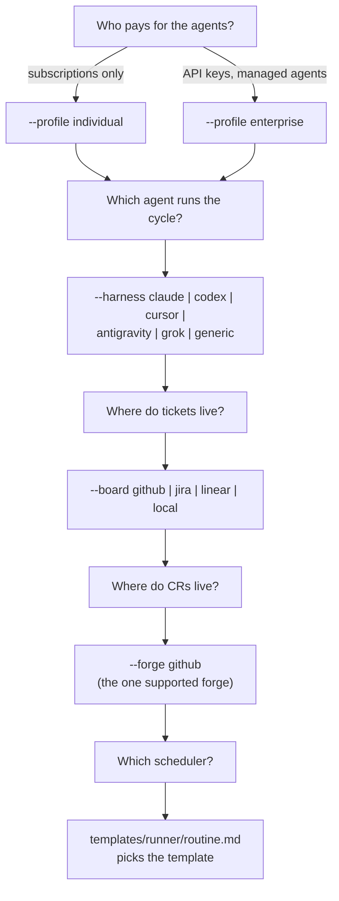
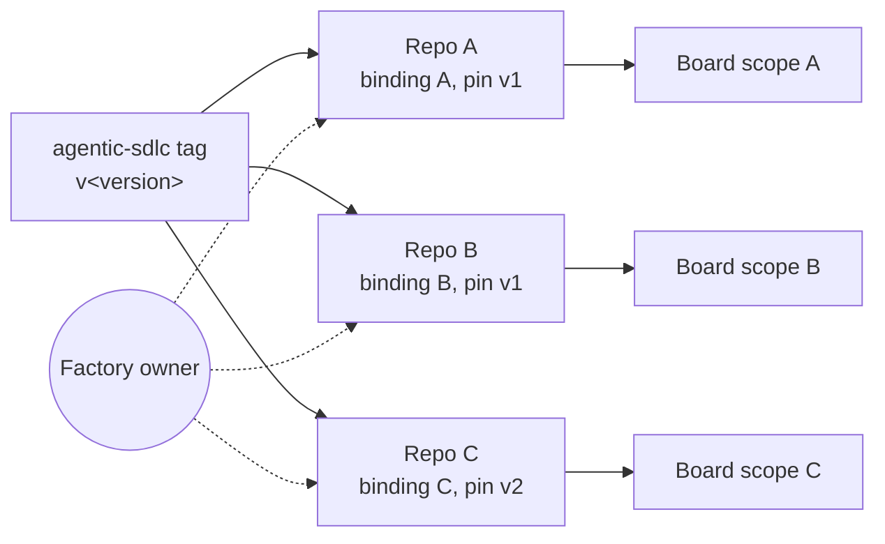

# Adoption

How to put the factory on a repo, and on many repos. The install commands are in the
[README](../README.md#install); this guide says which choices to make and in what order.

## Choose the setup

The forge is GitHub only. GitLab, Azure DevOps and Bitbucket were removed in 2.0.0-alpha.5: their
gates ran from a pipeline file the CR could change. See [forges.md](forges.md).

## Adopt on one repo

1. Install the CLI as a devDependency, pinned to a tag. The repo then owns its version.
2. Run `init` with the flags from the chart above.
3. Fill in `.agents/binding.yml`: owners, statuses, `commands.*`, `product.environments`,
   `product.delivery` (`release-line` or `continuous`), `product.evidence` (`sbom`, `provenance`,
   `signature`; set `commands.evidence_check` with it), `product.proofs`, `models`. The template
   documents every key. On GitHub with `release-line` delivery, also set up Environment `agentic-release`
   and the release workflow (see [forges.md](forges.md#github)).
4. Write `paths.importance_doc` and `paths.guiding_narrative`. The skills judge every ticket
   against them; without them every product question becomes a hold.
5. Run `doctor` until every port is ok.
6. Put two or three real tickets in Backlog with a Priority.
7. Run one cycle by hand: open the repo in the agent and run the `sdlc` skill for one cycle.
   Read the heartbeat and every comment it wrote.
8. Repeat step 7 until three cycles in a row need no correction from you.
9. Install the cycle and review schedulers from `templates/runner/`. Add the dead-man check
   (`ledger stale`).
10. Apply the [repo baseline](operating-baseline.md#repo-baseline) and the
    [board baseline](operating-baseline.md#board-baseline).

Done when a scheduled cycle writes a heartbeat with no `errors`, and a CR merges through the gates.

## Product types

The skills are the same for every product; the binding says what an environment and a proof are.

| Product | `product.environments` | `product.delivery` | Proofs | How it reports |
|---|---|---|---|---|
| Web service with continuous delivery | `[staging, production]` or `[production]` | continuous | test, visual, computer-use | Each deploy runs `gate shipped <env>`; a flag kill or rollback runs `--result rolled-back`. |
| Web or API product with approved releases | `[staging, production]` | release-line | test, visual, computer-use | `release` cuts; the production deploy from the release line reports. |
| Mobile app | `[internal, beta, store]` | release-line | test, visual, manual | The store step reports when review approves: `gate shipped store --result success` from the store webhook or by a person; a halted phased rollout reports `rolled-back`. |
| Library or package | `[registry]` | continuous | test | The publish job runs `gate shipped registry --version <published version>`; the gate tags it. |
| Data pipeline or ML model | `[staging, production]` (registry stages) | continuous | eval, data-check | A promotion runs `gate shipped <stage> --version <model version>`; a version pin runs `--result rolled-back`. |
| Docs or content site | `[production]` | continuous | visual, manual | `paths.no_proof` covers the content paths. |

## Move from a hand-made process

1. List what the old process does that the skills do not. Each item is a binding value, a
   doc that `paths.importance_doc` routes to, or a gap to report on this repo.
2. Run `init --force` on a branch, then copy the old values into the binding.
3. Delete the old copies of the skills. A project replaces the binding, never the skills.
4. Continue at step 5 of "Adopt on one repo".

## Many repos

- Each repo has its own binding and its own pinned version. Upgrade one repo at a time.
- Each repo has its own cycle and review schedulers, and its own heartbeat ticket.
- Give each repo its own board scope, so a cycle routes only its own tickets: a Jira
  `project_key`, a Linear `team_key`, or `board.options.repo` on a GitHub Project. Several repos
  can share one GitHub Project; each repo's adapter reads only that repo's issues.
- One person or team can be the Factory owner of many repos.
- `improve-factory` changes the copy of the skills in its own repo only. A change that should
  reach every repo goes upstream to this repo, then out with the next tag.
- Claude Code: the marketplace plugin has one version per user. A scheduled run should load the
  repo's pinned copy: `claude --plugin-dir ./node_modules/agentic-sdlc`.

## Upgrade

1. Read the CHANGELOG entries between your version and the new tag.
2. Bump the pinned version, then run `npm ci`.
3. Run `init` again without `--force`. It keeps your files and logs what it skipped.
4. Run `validate` and `doctor`.
5. Run one cycle by hand before the scheduler takes over.

Releases are tags. A pushed tag never moves.
