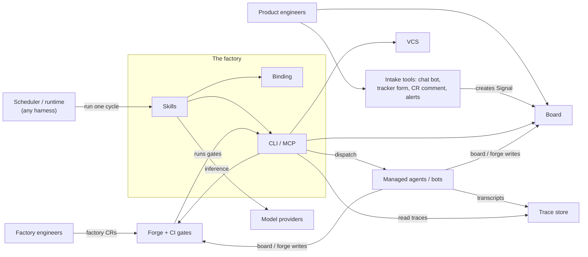
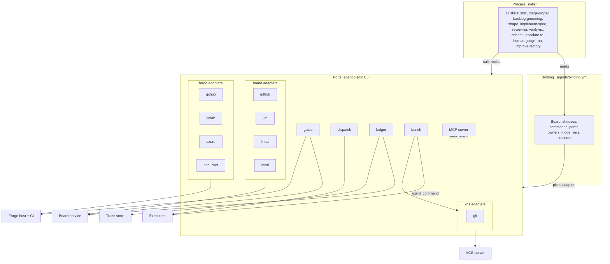
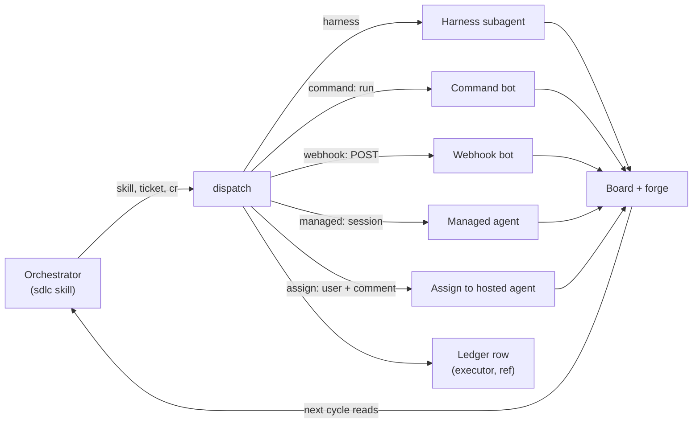
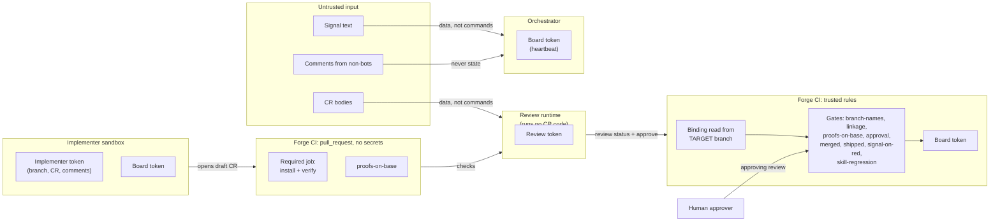
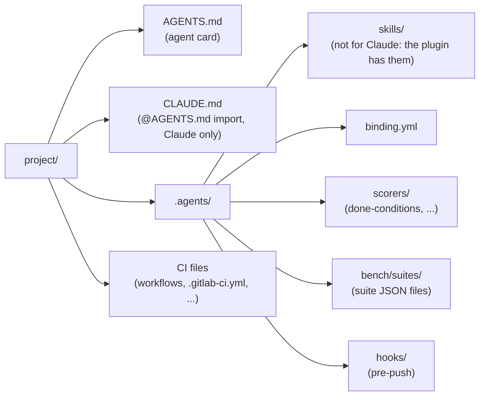

# Components

How the agentic-sdlc v2 factory is built. The contract is `references/architecture.md`. This page
only draws it.

## 1. Context

Purpose: show who and what the factory talks to.

- Product engineers talk to the board and the intake tools. They never call the factory directly.
- Factory engineers change skills and the binding through factory CRs on the forge.
- The board and the forge are the only hand-off between parts.

## 2. Layers and ports

Purpose: show the three layers and which port reaches which external system.

- Skills hold process only. The binding holds every project value. Ports hold mechanism only.
- A skill never calls a vendor CLI. It calls a port verb.
- The MCP server exposes the same verbs for agents with no shell.
- `bench run` is the one place the package starts an agent.
- For Claude Code the skills, hooks and MCP server ship as the `agentic-sdlc` plugin; other
  harnesses read the same skills from `.agents/skills/`.

## 3. Executors

Purpose: show how the orchestrator hands a stage to whoever runs it.

- Results come back only through board and forge writes. There is no direct reply channel.
- A second dispatch of the same ticket or CR, skill and head inside `cycle.dedupe_minutes` is a double fire. It is skipped.
- A dispatch is also skipped while the previous run of the same key has not finished, until `stall_minutes` pass.
- The rules for executors live in `skills/sdlc/references/executors.md`, part of the contract.

## 4. Trust boundaries

Purpose: show what runs where, which secret each part holds, and which inputs are untrusted.

- CI loads the binding from the target branch, never from the CR.
- CR code runs only in the no-secrets `Required` job. The review runtime reads its result and
  runs no install or test command.
- The implementer holds no review token. It cannot post `review` or approve.
- The `approval` gate posts `human-approval` only with the approvals the CR's class needs.
- Only heartbeats by accounts in `owners.bots` count as state.
- Secrets reach an executor only when its entry lists them.

## 5. Installed project layout

Purpose: show where the factory lives in a project that installed it.

- `.agents/` is the factory definition. Changing it is a factory change.
- Skills are copied whole, or come from the plugin. A project replaces only `binding.yml`.
- CI files call `agentic-sdlc gate <name>`.
