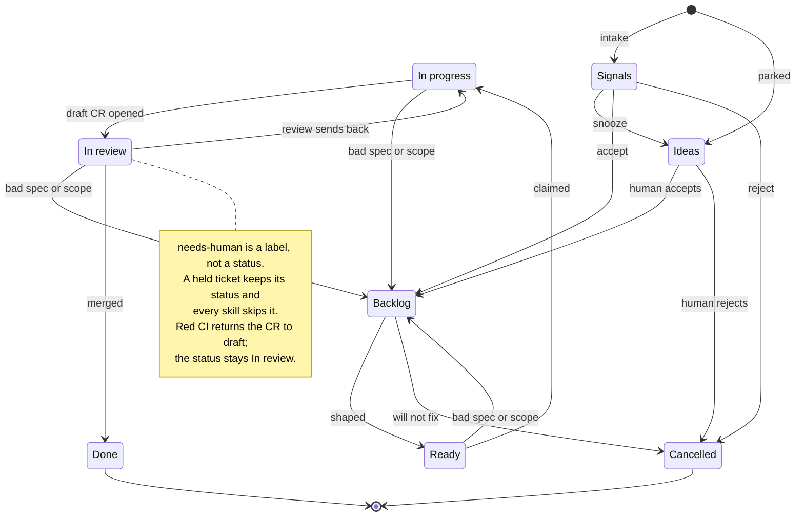
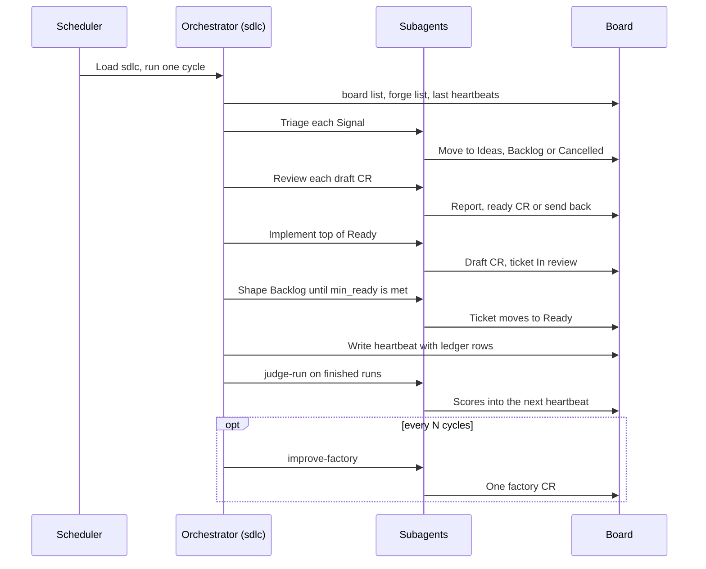
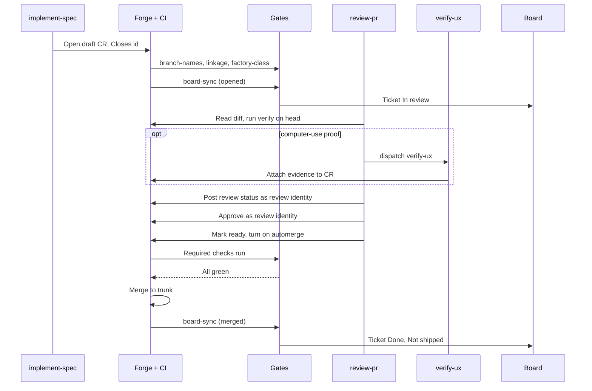
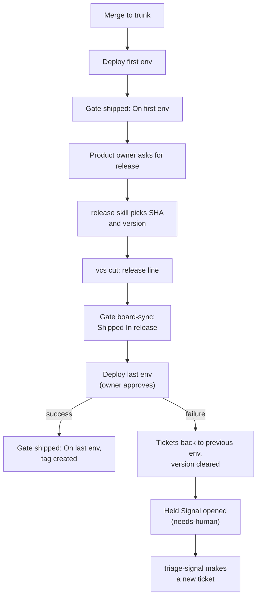
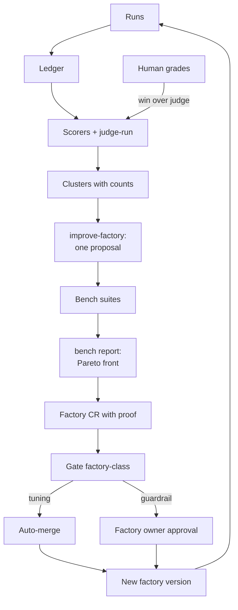
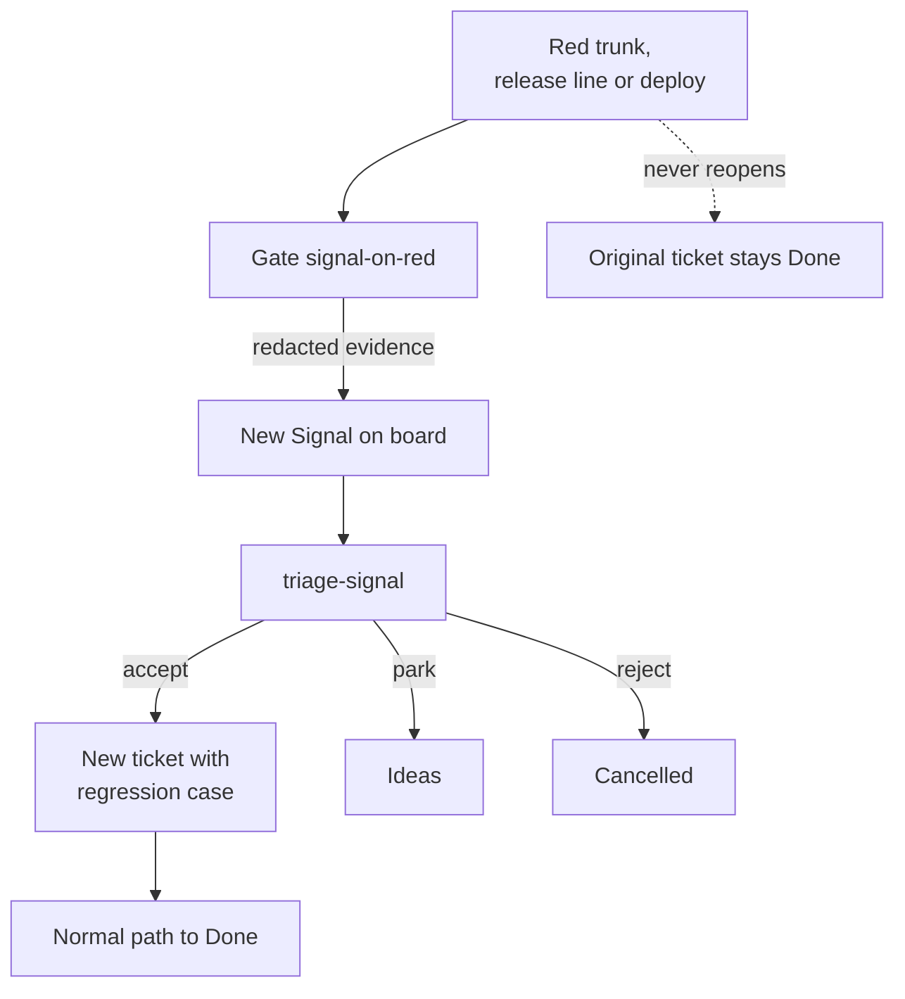

# Flows

How work moves through the agentic-sdlc v2 factory. The contract is `references/architecture.md`
and `skills/sdlc/SKILL.md`.

## 1. Ticket lifecycle

Purpose: show every status a ticket can hold and how it moves.

- Done is final. A later failure opens a new Signal, never reopens the ticket.
- Humans own Ideas. Skills never pick one up.
- Removing the `needs-human` label is the only release from a hold.

## 2. One cycle

Purpose: show the order of work in one scheduled run.

- The orchestrator routes, waits and reports. Subagents do the work.
- After `time_budget_minutes` nothing new starts.
- A failed step goes in the heartbeat `errors`. The cycle goes on.

## 3. Change request hand-off

Purpose: show how a draft CR becomes a merged change and a Done ticket.

- The implementer never reviews its own CR.
- Red or missing checks send the CR back to draft. The cause decides who fixes it.
- A CR behind the trunk is synced and reviewed again.

## 4. Delivery and release

Purpose: show how a merge reaches the last environment.

- Agents never approve the last environment. The Product owner does.
- A failed release line is left untouched. The fix ships under the next version.
- The tag is created at success in the last environment.

## 5. Self-improvement loop

Purpose: show how runs become one proven factory change.

- One change per proposal. A rule enters a skill only after the same mistake appears twice.
- The change must not lower the bench score or raise cost beyond its gain.
- Weekly spend on learning stays under the budget. Over budget, the loop stops.
- Unknown paths and deletions count as guardrail.

## 6. Signal on red

Purpose: show how a failure becomes a new ticket without reopening Done work.

- Only trunk and release-line runs open a Signal. Other refs are ignored.
- The fix is always a new ticket with a regression case in its criteria.
- A failure in the last environment adds the `needs-human` hold to the Signal.
