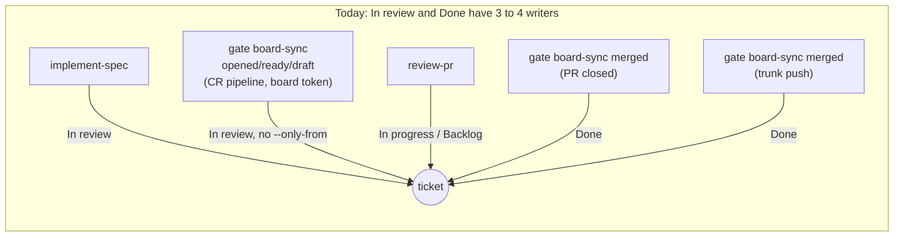
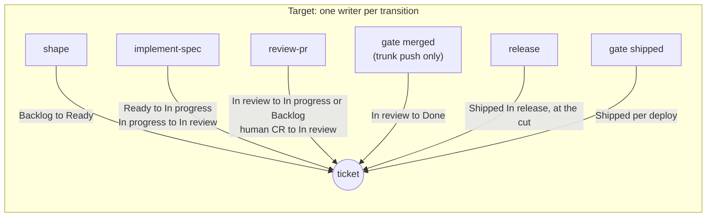

# Stress test of the whole setup (2026-11-13, at 05501fe)

Nine journeys were traced end to end through the skills, the CLI, the gate templates and the
runner templates. Each hand-off was checked for: who acts, which command, which token, and what
breaks if the step is missing, late, repeated or racing. Nothing ran against a live forge; every
finding comes from reading the files. **Confirmed** means the finding was re-read in the code for
this report. **Reported** means one tracer found it and it was not re-read.

## Journeys

| ID | Journey | Setup |
|---|---|---|
| J1 | Idea to a production tag | Solo, GitHub board and forge, staging and production |
| J2 | A human opens the CR by hand; rework; a CR that closes no ticket or two | Same |
| J3 | Send-back, rework, red CI, behind the trunk, a check that never reports | Same |
| J4 | Full lane, separate review identity, `human_approval: always`, last-push approval, `review_runtime: same` | Enterprise, GitHub |
| J5 | Production alert to P0, hold, fix, expedited release, failed production deploy, rollback, regression ticket | GitHub |
| J6 | Backlog to production | Enterprise, Jira board, GitLab forge |
| J7 | 20 cycles, judge, improve-factory, bench, factory CR | Non-developer owner, technical steward |
| J8 | Double fire, overlapping runs, `parallel_agents: 3`, time budget, held heartbeat ticket, 1000+ items, two repos on one Project, gate and skill racing | Any |
| J9 | Continuous delivery, a mobile app, a data or ML pipeline, a library, Azure or Bitbucket with Jira | Any |

## The main result: too many writers per board field

The board has one field per fact, but several writers race for the same field. A skill moves a ticket
with `--only-from`; a gate moves the same ticket seconds later with no such check. Most breaks below come
from this.

Rule: the actor that causes a transition writes it, once, with `--only-from`. No gate in a CR pipeline
writes the board. Then the CR pipeline needs no board secret on any forge.

## Verdict per automation

| Automation | Verdict | Evidence |
|---|---|---|
| `board-sync` events `opened`, `ready`, `draft` | **Delete.** implement-spec moves to In review after `forge open` and after a rework push; review-pr moves a human CR to In review when it first sees it. | Confirmed. All three run one code path (`src/gates.ts` boardSync, move with no `--only-from`). The CR workflow maps every push or edit of a draft CR to `draft` (`templates/gates/github/agentic-sdlc-cr.yml` Board sync), so a send-back to In progress is undone a minute later; the routing then sends the ticket back to review-pr. A `ready` run racing an auto-merge can reset Done to In review. A board outage fails the required `ticket-linkage` check, because board-sync is a step in that job. |
| `board-sync merged` on PR closed | **Delete.** | Confirmed duplicate of the trunk-push step; two unordered writers. |
| `board-sync merged` on trunk push | **Keep as `gate merged`**, with `--only-from "In review"`. Done records a fact (the code is on the trunk), so a held ticket still moves; the contract text "held tickets are skipped" changes. | Confirmed: today it moves held and Cancelled tickets with no check, against the contract. |
| `board-sync in-release` | **Move into `release`**: the skill sets In release on each ticket in the same step as `release_version` and the cut. | Reported: the release-line push races the production deploy, so a fast failure finds nothing In release to roll back; on GitLab the job is skipped on failure; Azure has no release-line event by default. |
| `gate shipped` | **Keep and generalise.** Add `--result rolled-back` and `--version <v>`; ship the last environment from the trunk when `product.delivery: continuous`; key the failure reset on `release_version`; open one Signal, with a `### Needs human` ask. | Confirmed: the GitHub template ships the last environment only from a release line, so continuous delivery never reaches On production. Confirmed: a failed deploy opens two Signals (`shipped` plus `signal-on-red` on the same run). |
| `signal-on-red` | **Keep, skip deploy workflows.** | Confirmed duplicate above. |
| `human-approval` gate | **Keep, close the spoof.** Only the gate may post `human-approval`: guard `forge status --context human-approval` the same way as `forge approve`, and pin the context to an app where the forge allows it. | Confirmed: `forge status` takes any context, the guard blocks only `approve`, the ruleset does not pin `review` or `human-approval`, and the review run holds the review token. An injected review agent can post `human-approval: success`. |
| Review token placement | **Fix.** The runner's `review` job must use the `agentic-review` Environment that the CR workflow documents, or the docs must change. | Confirmed: the review job reads `secrets.AGENTIC_REVIEW_TOKEN` with no `environment:`. |
| Review event relay | Keep. | The only safe way to re-run `human-approval` after a human review on GitHub. |
| `review_runtime: same` | **Delete.** | Reported: the shipped runner cannot run it (the cycle denies `forge approve`), and it puts the review token next to CR code. |
| `learning.human_sample` | **Delete.** | Confirmed: `init` writes it; nothing reads it. |

## Breaks, by priority

### P1: a journey ends in a wrong state, or a control can be bypassed

| # | Break | Status | Where |
|---|---|---|---|
| 1 | The `draft` board event undoes every send-back, and loops the ticket back to review-pr. | Confirmed | CR workflow Board sync; `boardSync` |
| 2 | An injected review agent can post `human-approval: success`. | Confirmed | `src/forge/index.ts` status; `hooks/guard.mjs`; trunk ruleset |
| 3 | The cycle never dispatches a release request, a P0 release, or a sent-back ticket at In progress while Ready holds `cycle.min_ready` tickets. Step 4 reads only Ready; step 5 routes Backlog only when Ready is short. | Confirmed | `skills/sdlc/SKILL.md` Run one cycle |
| 4 | `proofs-on-base` fails every product CR with no new or changed proof file (docs, config, `manual` or `visual` criteria), and it is required. | Confirmed | `src/gates.ts` proofsOnBase |
| 5 | A merge moves a held or Cancelled ticket to Done, against the contract. | Confirmed | `boardSync` merged |
| 6 | Continuous delivery never reaches On production with the stock GitHub template. | Confirmed | `agentic-sdlc-delivery.yml` Shipped |
| 7 | GitLab, Azure, Bitbucket: the CR pipeline file can read the gate secrets; on GitLab, `human-approval` exits 0 while pending, so "pipelines must succeed" does not block. | Confirmed (exit code), Reported (status attachment) | `src/gates.ts` CLI `approval`; GitLab template |
| 8 | The dispatch idempotency key uses the runner's trunk HEAD for a `--ticket` dispatch, so a re-review, a rework or a release resume inside `stall_minutes` prints `skipped`. | Reported | `src/dispatch.ts` key |
| 9 | Judge and learn rows are produced after the heartbeat is written, and no channel carries them to the next cycle. `improve-factory` may then be due on every cycle. | Reported | `skills/sdlc/SKILL.md` steps 6 to 8 |
| 10 | `dispatch improve-factory` exits 2: it needs `--ticket` or `--cr`, and the cycle passes neither. | Confirmed | `src/dispatch.ts` |
| 11 | `learning.due` ignores the weekly budget. | Confirmed | `src/ledger.ts` learningState |
| 12 | Two repos on one GitHub Project collide by issue number. | Confirmed | `src/board/github.ts` |

### P2: a journey stalls, duplicates work or needs a hand fix

| # | Break | Status |
|---|---|---|
| 13 | `shipped` for the first environment runs before the merge gate marks Done, and skips the ticket until the next deploy. | Reported |
| 14 | One failed deploy opens two Signals; a re-run adds a third. The held Signal has no ask and no `env:` label. | Confirmed (two), Reported (rest) |
| 15 | The release go-ahead reads `--trusted`, which also passes bot and Factory owner comments. | Confirmed (filter), Reported (impact) |
| 16 | A closed, unmerged CR strands its ticket at In review; a send-back to Backlog leaves the CR open. | Reported |
| 17 | The release ready check needs "a recorded rollback run", which no verb records. | Reported |
| 18 | review-pr treats a pending `human-approval` or a missing `review` status on a new head as a stalled check, and may draft a healthy CR. | Reported |
| 19 | review-pr has no branch for a red check on a draft CR. | Reported |
| 20 | The factory reviews and takes over a human's work-in-progress CR, and rework can push onto the human's branch. | Reported |
| 21 | Triage, shape and escalate can hold a P0 twice: shape changes Size, Lane and criteria, which count as new facts. | Reported |
| 22 | Milestones cannot be set: no board verb writes one, and `board.later_milestone` is not in the binding template. | Reported |
| 23 | Scale caps: 1000 Project items, 100 merged CRs, an unbounded heartbeat comment (about 380 open items reach GitHub's 65,536-character limit). | Confirmed (caps), Reported (heartbeat) |
| 24 | `ledger stale` only exits 1; the docs say it opens a Signal. It runs in the same scheduled workflow, so it cannot see the scheduler stop. | Reported |
| 25 | The bench replays only implement-spec, but a `review-pr` tier change classifies as benched `tuning`. A brand-new project has too few cases to prove anything. | Reported |
| 26 | Templates hold literals `first-env` and `last-env`; nothing checks that they were replaced. | Confirmed |
| 27 | `judge_tier: deep` in the template against a code default of `fast`. | Confirmed |

### P3: model gaps for product types (J9)

| Product | Gap |
|---|---|
| Continuous delivery, one environment | No `product.delivery` mode; release keys stay required; flag-dark code counts as On production. |
| Mobile | Store review and phased rollout have no event; the version is fixed at build, before the release skill sets it; a binary cannot be rolled back. |
| Data or ML | A deploy is an artifact, not a commit; rollback is a version pin with no `shipped` result; evals need secrets that `Required` does not hold. |
| Library | The release is the tag plus the publish; the gate tags after the publish; no maintenance line for a back-port. |
| Jira with Azure or Bitbucket | Jira workflow transitions and the Shipped field options are set up by hand and not checked by `doctor`. |

## Order of work

1. **Board writers.** Delete the CR-event board moves; implement-spec and review-pr own In review;
   `gate merged` on the trunk push only, `--only-from "In review"`; release sets In release. This
   fixes breaks 1, 5, 13, 16 and removes the board secret from every CR pipeline, which shrinks
   break 7.
2. **Controls.** Guard and pin `human-approval`; fix the review token placement; delete
   `review_runtime: same`; the release go-ahead reads only `owners.product`.
3. **Cycle routing.** Make the cycle evaluate every routing row each run, with
   `cycle.max_implementations` as the only cap on new implementations; fix the dispatch key; carry
   judge and learn rows; give `improve-factory` its own dispatch and schedule; `due` checks the budget.
4. **Delivery model.** `product.delivery`, `shipped --result rolled-back --version`, one Signal per
   failure, `proofs-on-base` passes a product CR whose criteria have no proof file.
5. **Scale.** Repo filter and paging on the GitHub board; per-ticket CR lookup.

Each step changes the contract, the skills, the feature files and the flows in the same commit.

## Round 2 (after the five fix steps)

Four fresh tracers re-ran the journeys on the fixed code, plus one consistency audit of docs against
code. Round 2 found 5 new P1 breaks, three of them races between the remaining board writers. Their
fixes are in the commit "round 2 fixes".

| Round 1 P1 | Status |
|---|---|
| 1 draft event undoes a send-back | Fixed: no CR-pipeline gate writes the board. |
| 2 a review agent can post `human-approval` | Fixed for agents: `forge status` refuses gate contexts. Code the cycle runs could still post one with raw HTTP: give the implementer token no commit-status write, and pin the context to the review app. |
| 3 cycle starves releases and rework | Fixed: the cycle walks every routing row. |
| 4 `proofs-on-base` blocks docs-only CRs | Fixed: `paths.no_proof`. |
| 5 a merge moves a held or Cancelled ticket | Changed: Done records the merge and keeps the label; Cancelled stays. |
| 6 continuous delivery never ships | Fixed: `product.delivery`. |
| 7 GitLab, Azure, Bitbucket gate secrets | Open: the pipeline file is the CR author's. Gates there are advisory until a trunk-defined pipeline holds them. |
| 8 dispatch key skips re-runs | Fixed: a double-fire window, plus a block while a run is unfinished. |
| 9 judge and learn rows lost | Fixed: heartbeat kinds; judge first; improve-factory writes its own heartbeat. |
| 10 `dispatch improve-factory` exits 2 | Fixed. |
| 11 `learning.due` ignores the budget | Fixed; a budget of 0 turns learning off. |
| 12 two repos on one GitHub Project | Fixed: the adapter reads only its repo. |

| Round 2 P1 | Status |
|---|---|
| `merged` and `shipped` race on GitLab | Fixed: one resource group; `merged` tolerates the move; writes read again first. |
| Concurrent `shipped` runs lower Shipped | Fixed: one queue on GitHub; `shipped` never lowers a newer value. |
| Release cut needs an admin implementer | Fixed on GitHub: `forge cut` and the release workflow behind an Environment the Product owner approves, with its own release bot. Elsewhere: `vcs cut` under a release credential. |
| `learning` runs inside the cycle timeout | Fixed: improve-factory writes its own heartbeat; give it its own executor for long benches. |
| Bench spend outside the budget | Fixed: `bench run --budget` with the week's remainder; the improve-factory row carries bench cost. A harness that reports no cost still leaves the budget blind. |

The open items moved to the [roadmap](../roadmap.md).
