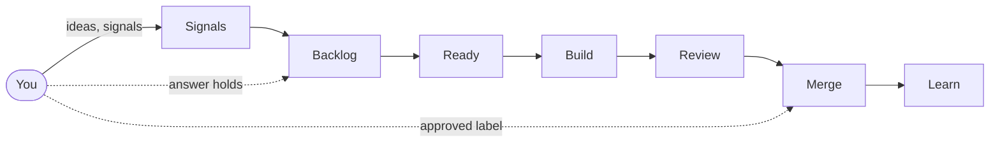

# 1. What it is
<!-- group: Understand -->

agentic-sdlc delivers a product for you with Claude Code agents. Your GitHub issues are the board.
A scheduled cloud run, the **cycle**, moves each issue one step at a time, from a raw signal to a
merged and shipped change. CI checks decide what may merge, and no agent can skip them. You act
when a rule says a person must decide, and you can do that from a phone.

The skills (the process), your settings (the **binding**, `.agents/binding.yml`), the `agentic-sdlc`
CLI and the CI checks together are the **factory**.

## What it guarantees

| Guarantee | How |
|---|---|
| No change merges without its checks | Six required CI checks decide every merge. They read their rules from the main branch, never from the change. |
| The reviewed code is the tested code | CI runs the tests with no secrets. The review reads the result and never runs the change's code. |
| You are asked, not bypassed | A rule makes a step stop and ask you: a product ruling, security, money, something that cannot be undone. |
| Every run leaves a record | Each cycle writes a heartbeat: what ran, on which model, what failed. A separate check notices when the cycle goes quiet. |

## Is it for you

**A good fit:** one developer with a product on GitHub, tests that run in CI, work you can write as
issues, and a Claude subscription.

**Not a fit:** a forge other than GitHub, work with no automated checks, or a need for a second
person to approve every change. It is early (0.1): interfaces may change before 1.0, and no full
cycle has run yet on a real repository in a cloud routine.

You need: a GitHub repository with CI, Claude Code on your Claude subscription (no API key), and a
computer once, to install it. After that, the cycle runs in a Claude cloud routine and you work from
the GitHub and Claude apps.

Next: [2. A ticket's journey](2-a-ticket.md).
