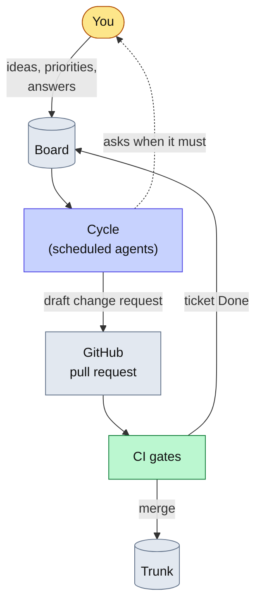

# 1. What it is

agentic-sdlc runs software delivery with agents. You put work on a board. A scheduled agent run,
the **cycle**, moves each ticket one step: it shapes the ticket, builds it, reviews it and merges it.
CI **gates** decide what may merge, and no agent can skip them. You act only when the factory asks
you, or when you want to steer it.

## Three layers

| Layer | Where | Holds |
|---|---|---|
| Skills | the plugin (Claude) or `.agents/skills/` | The process: every rule. The same for every project. |
| Binding | `.agents/binding.yml` | Your project's values: board, owners, commands, environments, models. |
| CLI | `agentic-sdlc` (and its MCP server) | The mechanism: board, forge and Git verbs, the gates, dispatch, the run ledger. |

A project changes only its binding. A skill never calls a vendor tool: it calls the CLI.

## Eleven skills

Seven run in every project. Four run only when the binding asks for them.

| Stage | Skill | Does | Runs |
|---|---|---|---|
| Navigate | `sdlc` | Runs one cycle: routes each ticket to the next skill. | always |
| Intake | `triage-signal` | Turns one raw signal into Backlog, Ideas or Cancelled. | always |
| Intake | `backlog-grooming` | Sets Priority, merges duplicates, groups work. | always |
| Plan | `shape` | Takes a Backlog ticket to Ready: size, criteria with proof, lane, spec. | always |
| Build | `implement-spec` | Writes the proof first, then the code, then opens a draft change request. | always |
| Check | `review-pr` | Reviews the change request against its ticket and CI, then merges or sends it back. | always |
| Check | `verify-ux` | Uses the running change as a user for `computer-use` criteria. Apart from `review-pr` because it runs the change's code. | a criterion names `computer-use` |
| Ship | `release` | Chooses what ships, sets the version, cuts the release line. | release-line delivery |
| People | `escalate-to-human` | Decides whether a person must act; holds the ticket with one question. | always |
| Learn | `judge-run` | Grades each finished run. | `learning.enabled` |
| Learn | `improve-factory` | Proposes one factory change, with proof. | `learning.enabled` |

## Words

| Word | Means |
|---|---|
| Ticket | One item on the board. Its **status** says where it stands. |
| Change request (CR) | A pull request. A **change line** is its short-lived branch. |
| Lane | Fast (small, low risk: merges on the agent review) or Full (also needs a human approval). |
| Proof | How a criterion is shown done: a test, an eval, a visual check, a data check, `computer-use` or `manual`. |
| Gate | A CI job that posts a required check. Agents cannot skip it. |
| Hold | The `needs-human` label: every skill skips the ticket until a person answers. |
| Heartbeat | One comment per cycle on the heartbeat ticket: what ran and what failed. |

Next: [2. Choose your setup](2-choose.md).
