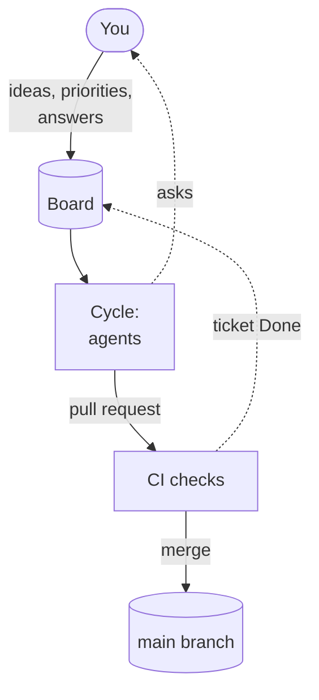

# 1. What it is
<!-- group: Understand -->

agentic-sdlc runs software delivery with agents. You put work on a board. Every hour, a scheduled
agent run (the **cycle**) moves each ticket one step: it shapes the ticket, builds it, reviews it
and merges it. CI checks decide what may merge, and no agent can skip them. You act when a rule
says a person must decide. Together, the skills, your settings, the CLI and the CI checks are the
**factory**.

## What it guarantees

| Guarantee | How |
|---|---|
| No change merges without its checks | Six required CI checks decide every merge. The checks read their rules from the main branch, never from the change. |
| The code that is reviewed is the code that is tested | CI runs the tests with no secrets; the review reads the result and never runs the change's code. |
| You are asked, not bypassed | A rule makes a skill stop and ask you: a product ruling, security, money, something that cannot be undone. |
| Every run leaves a record | Each cycle writes a heartbeat: what ran, on which model, what failed. |

## Is it for you

**A good fit:** a product on GitHub with tests in CI, work you can write as tickets, and a Claude
subscription for Claude Code.

**Not a fit yet:** a forge other than GitHub; a team that cannot let agents open pull requests; work
with no automated checks. It is early (0.1): interfaces may still change before 1.0.

You need: a GitHub repo with CI, the repo's GitHub issues as the board, Claude Code
on your Claude subscription, and a place to run the cycle (a Claude cloud routine, GitHub Actions or your own machine).

Next: [2. A ticket's journey](2-a-ticket.md).
