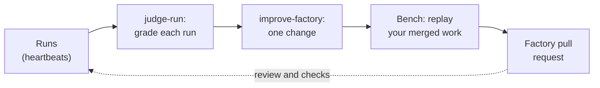

# 10. Learning
<!-- group: Operate -->

Optional. Off until you set `learning.enabled: true` and an `agent_command` for the bench. The
factory then improves its own skills, one proven change at a time.

1. `judge-run` grades each finished run with the scorers in `.agents/scorers/`, on a different model
   than the run used. Your own grades always win over the judge's.
2. Every `learning.every_cycles` cycles, `improve-factory` finds the worst failure that repeats in at
   least `learning.min_evidence_runs` runs.
3. It proposes exactly one change: a skill sentence, a setting, a check or an executor.
4. The bench replays cases built from your merged work, with the change and without it. The change
   must not lower the pass rate (`learning.bench_min_cases`, `bench_trials`, a Wilson lower bound).
5. The change goes through review and the checks like any other. A `guardrail` change needs the
   factory owner; a `tuning` change (the model map) may merge alone once a bench baseline exists.

Next: [11. The parts](11-parts.md).
