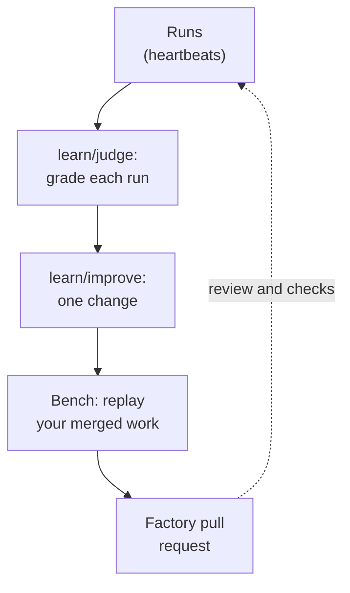

# 10. Learning
<!-- group: Operate -->

Optional. Off until you set `learning.enabled: true` and an `agent_command` for the bench. The
factory then improves its own skills, one proven change at a time. Both steps belong to the
`learn` skill.

1. `learn/judge` grades each finished run with the scorers in `.agents/scorers/`, on a different model
   than the run used. Your own grades always win over the judge's. Scorers cover shape quality and
   triage accuracy as well as the code steps. A judge with missing or unreadable evidence grades
   `unscorable` and says why; the run is counted as such in `ledger summary` and is no evidence for
   a failure cluster.
2. Every `learning.every_cycles` cycles, `learn/improve` finds the worst failure that repeats in at
   least `learning.min_evidence_runs` runs.
3. It proposes exactly one change: a skill sentence, a setting, a check or an executor.
4. The bench replays cases built from your merged work, with the change and without it. The change
   must not lower the pass rate (`learning.bench_min_cases`, `bench_trials`, a Wilson lower bound). `learning.bench_budget` caps a bench run: a plan over `max_runs` is refused, and after `max_minutes` no new case starts. Skipped cases make the result incomplete, which never counts as a pass.
5. The change goes through review and the checks like any other. A `guardrail` change needs the
   factory owner; a `tuning` change (the model map) may merge alone once a bench baseline exists.

The run rows behind all of this can also go to your own telemetry stack as OpenTelemetry GenAI spans
and CDEvents; see [Send it to your telemetry](9-run-it.md#send-it-to-your-telemetry).

Next: [11. The parts](11-parts.md).
