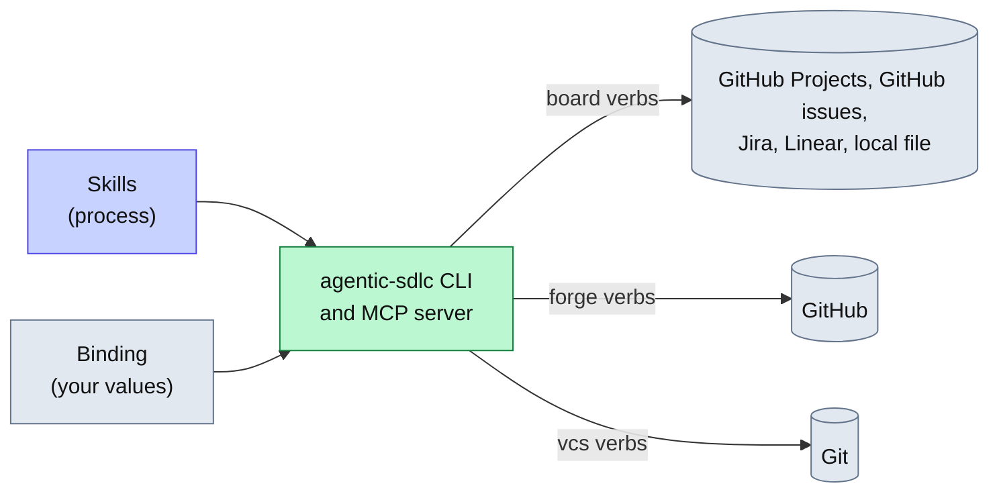
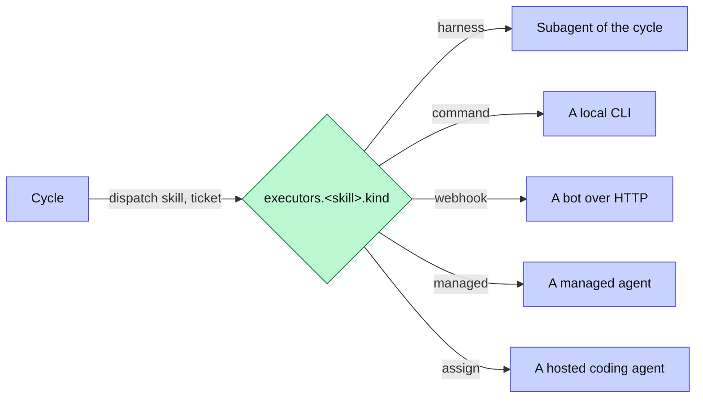

# 10. The parts

How the factory is built. The normative contract is
[`references/architecture.md`](../../references/architecture.md); this chapter only draws it.

## Layers and ports

- A skill calls `agentic-sdlc board|forge|vcs <verb>`, never a vendor CLI. Agents with no shell use
  the same verbs through the MCP server.
- The board and the forge are the only hand-off between parts. There is no other channel.

## Who runs a step: executors

Each executor entry may also name its MCP servers, its secrets (env var names only; nothing else is
passed), its sandbox (`cloud`, `container` or `local`) and its model. Results come back only as board
and forge writes. The rules are in [`executors.md`](../../skills/sdlc/references/executors.md).

## Trust boundaries

| Part | Runs | Holds | Never |
|---|---|---|---|
| CI `Required` job | The change's code (install, tests) | No secrets | Posts a status a gate owns |
| CI gates | The CLI only, with the binding from the target branch | The job token, the board token | Reads the binding from the change |
| The cycle and implementers | Agents and their tools, in their sandbox | Forge and board tokens | Holds the review token |
| The review | Reads CI results and the diff | The review token (two identities only) | Runs the change's code |
| `verify-ux` | The change's preview, in a browser | Test credentials | Holds the review token |

Untrusted input is data, never instructions: Signal text, change request bodies, and comments by
accounts outside `owners`.

## What `init` puts in your project

| Path | Holds |
|---|---|
| `.agents/binding.yml` | Every project value. The one file a project changes. |
| `.agents/skills/` | The skill pack (Claude with the plugin reads the plugin's copy). |
| `.agents/scorers/` | The scorers `judge-run` uses. |
| `.agents/cycle-prompt.md`, `review-prompt.md`, `runner-setup.sh` | What a scheduler runs. |
| `.agents/hooks/pre-push` | Refuses a push to the trunk. |
| `.github/workflows/agentic-sdlc-*.yml`, `.github/rulesets/` | The gates and the trunk protection. |
| `AGENTS.md` (and `CLAUDE.md` for Claude) | A pointer for every agent: start with the `sdlc` skill. |

Changing anything under `.agents/` or `.github/` is a factory change.

Back to the start: [1. What it is](1-what-it-is.md). Full behaviour, scenario by scenario:
[docs/behaviour](../behaviour/README.md).
