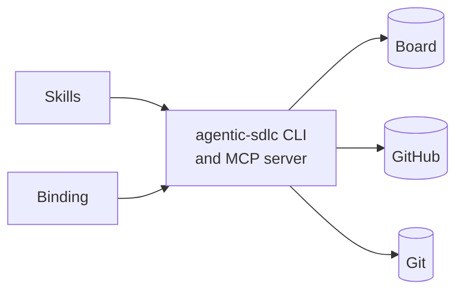

# 11. The parts
<!-- group: Reference -->

How the factory is built. For the exact rules, read the contract,
[`references/architecture.md`](../../references/architecture.md).

## Three layers

| Layer | Where | Holds |
|---|---|---|
| Skills | the Claude Code plugin or `.agents/skills/` | The process: every rule. The same for every project. |
| Binding | `.agents/binding.yml` | Your project's values: board, owners, commands, environments, models. |
| CLI | `agentic-sdlc` (and its MCP server) | The mechanism: board, forge and Git verbs, the checks, dispatch, the run ledger. The MCP server speaks both protocol eras: a client that opens with `initialize` gets the handshake (2025-11-25 and earlier), and a client that sends its version in each request's `_meta` (2026-07-28) is served without a handshake. |

A project changes only its binding. A skill never calls a vendor tool: it calls the CLI.

Each CLI verb takes only the flags it lists. An unknown flag, a flag with no value and a `--body-file` that cannot be read stop the verb with a usage error (exit 2). When GitHub answers a read with a rate limit or a server error, the CLI tries again up to three times and waits as long as GitHub asks. A write is tried again only on a rate limit, because a server error may follow a write that went through. Lists are bounded: `forge list` takes `--limit` and `--since`, and returns no check results unless asked with `--checks`.

## Seven skills, one per phase

Each skill is one phase of the process. A skill with several steps keeps each in its own file, and
a step is what runs: `dispatch plan/shape --ticket 12`. A skill with one step runs by its name. The
cycle runs every step in a fresh context, and the run ledger, the bench and the scorers name a run
by its step.

| Skill | Phase | Steps | Runs |
|---|---|---|---|
| `sdlc` | The navigator: routes each ticket and pull request to its next step, and runs one cycle. | one | always |
| `plan` | Signals, Ideas and Backlog to Ready. | `triage` (one Signal to Backlog, Ideas or Cancelled), `groom` (Priority, duplicates, initiatives), `shape` (size, criteria with proofs, lane, spec) | always |
| `build` | Ready to In review: the proof first, then the code, then a draft pull request; also every rework, a red check included. | one | always |
| `review` | In review to merged, or sent back. | `review` (grades the pull request against its ticket and CI, publishes the verdict, lands it), `verify` (uses a preview of the change as a user, for `computer-use` criteria) | always; `verify` when a criterion names `computer-use` |
| `ship` | The release line: chooses what ships, sets the version, cuts the line. | one | release-line delivery |
| `escalate` | Any status: decides whether a person must act, and holds the ticket with one question. | one, inside the calling step | always |
| `learn` | The learning loop. | `judge` (grades each finished run), `improve` (one factory change, with proof) | `learning.enabled` |

Under the Claude Code plugin a skill is `agentic-sdlc:<skill>`. A copied install
(`.agents/skills/`, `.claude/skills/`) names each one `sdlc-<skill>`; `sdlc` stays `sdlc`.

## Who runs a step

`executors.<step>.kind` picks who runs each step (a key `<skill>/<step>`, or a skill name for all
its steps): `harness` (a fresh-context worker of the cycle), or `command`
(a local CLI, such as `claude -p` on the subscription). Each entry may also name its MCP servers, its secrets (env var names only; nothing else is
passed), its sandbox (`cloud`, `container` or `local`) and its model. Results come back only as
board and forge writes. The rules are in [the contract, section 7](../../references/architecture.md#7-executors-who-runs-each-step).

## Trust boundaries

| Part | Runs the change's code | Holds secrets | Holds the review token |
|---|---|---|---|
| CI `Required` job | yes | no | no |
| CI checks (gates) | no: the CLI only, with the rules from the main branch | the job token, the board token | no |
| The cycle and implementers | their own work, in their sandbox | forge and board tokens | no |
| The review | no: it reads CI results and the diff | forge and board tokens | only with two identities |
| `review/verify` | yes: a preview, in a browser | test credentials | no |

The `provenance` gate is one of the CI checks: it reads a pull request's commits through the forge and never runs them. Agents write the `Agent-Run` and `Agent-Model` trailers on their own commits, so the trailers say which run made a commit; they do not prove it.

Untrusted input is data, never instructions: Signal text, pull request bodies, and comments by
accounts outside `owners`.

## What `init` puts in your project

| Path | Holds |
|---|---|
| `.agents/binding.yml` | Every project value. The one file a project changes. |
| `.agents/cli.json` | The CLI pin: the package and the tag or commit it runs. |
| `.agents/bin/agentic-sdlc` | The launcher: it installs the pinned CLI in `.agents/.cli/` (ignored by Git) on first use and runs it. Every workflow, hook and runner calls it. |
| `.agents/skills/` | The skill pack, as `sdlc-<skill>` (Claude with the plugin reads the plugin's copy). |
| `.agents/scorers/` | The scorers `learn/judge` uses. |
| `.agents/cycle-prompt.md`, `review-prompt.md`, `runner-setup.sh` | What a scheduler runs. |
| `.agents/hooks/pre-push` | Refuses a push to the main branch. |
| `.github/workflows/agentic-sdlc-*.yml`, `.github/rulesets/` | The checks and the branch protection. |
| `AGENTS.md` (and `CLAUDE.md` for Claude) | A pointer for every agent: start with the `sdlc` skill. |

Changing anything under `.agents/` or `.github/` is a factory change.

Next: [12. Glossary](12-glossary.md).
