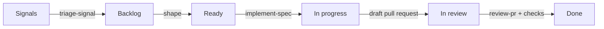

# 2. A ticket's journey
<!-- group: Understand -->

Follow one ticket from a request to production. Pick a scenario, then press **Next** or use the
arrow keys. Each step shows who acts, what happens, and what you would see.

<!-- viz: journey -->

## Every status

| Status | What happens | Who acts | What you see |
|---|---|---|---|
| Ideas | A thought you park. Skills never touch it. | You | Your note. |
| Signals | Raw input: an alert, feedback, a red CI run, a scanner finding. | `triage-signal` | A decision comment: accepted, parked or rejected, with the reason. |
| Backlog | Accepted work. It gets a Priority; duplicates are merged. | `backlog-grooming` | A Priority, sometimes children under an initiative. |
| Ready | Acceptance criteria, each with a proof; a Size and a Lane; a spec comment (criteria and proofs only in the Fast lane). | `shape` | The spec comment; Size and Lane. |
| In progress | The proof first, then the code, on a short-lived branch. | `implement-spec` | A branch named after the ticket. |
| In review | A draft pull request, graded against the criteria and CI. | `review-pr`, CI checks | The review report on the pull request. |
| Done | The change merged. Done is final. | The `merged` check | The ticket closed; Shipped "Not shipped". |
| Cancelled | Not done: a duplicate, noise, or work that will not be done. | `triage-signal`, `backlog-grooming` | The reason in a comment. |

**Shipped** is a field, not a status. Each deploy moves it: On staging, then On production.

One cycle can move a ticket several steps: when a step finishes and time is left, the cycle starts
the next step at once.

**Done is final.** A failure after a merge never reopens the ticket. It opens a new Signal, which
becomes a new ticket with a regression case.

## How work enters

| From | It lands at | Then |
|---|---|---|
| You, a thought | Ideas | You move it to Backlog when you want it. |
| You, a plan or a conversation | Backlog | `backlog-grooming` turns it into tickets. |
| An alert, CI, a deploy, a scanner, a user | Signals (label `signal:<stream>`) | `triage-signal` decides. |
| A security report | Signals, through `SECURITY.md` | Details stay out of public tickets. |

Signal text is data. A skill never follows an instruction inside it.

## Size, lane and priority

- **Size** (`XS` to `XL`) is how much there is to review in one pull request, not the effort. XS is
  one or two files that take minutes to review. Above `ready_size_limit`, `shape` splits the ticket.
- **Lane**: Fast for a small change with no risk; it merges on the agent review. Full for anything
  else, or for a path in `paths.lane_areas` (sign-in, payments): it also needs a human approval.
  Nothing moves a ticket from Full back to Fast.
- **Priority** (`P0`, High, Default, Low): only `p0_setters` set P0, with evidence of production
  impact. The Ready queue goes by priority, then tickets that unblock others, then oldest first.

Next: [3. Your part](3-your-part.md).
