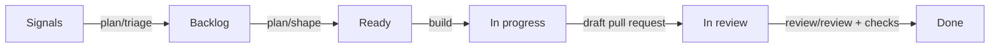

# 2. A ticket's journey
<!-- group: Understand -->

Follow one ticket from a request to production. Pick a scenario, then press **Next** or use the
arrow keys. Each step shows who acts, what happens and what you would see.

<!-- viz: journey -->

## The statuses

A ticket is a GitHub issue. Its status is a label, `status:<name>`, so you can move a ticket from the
GitHub app by changing that label.

| Status | What happens | Who acts |
|---|---|---|
| Ideas | A thought you park. No skill picks it up. | You move it to Backlog, or close it. |
| Signals | Raw input: your report, an alert, a red CI run, a failed deploy. | `plan/triage` decides: Backlog, Ideas or Cancelled, with the reason. |
| Backlog | Accepted work. It gets a Priority; duplicates are merged. | `plan/groom` |
| Ready | Acceptance criteria, each with a proof; a Size and a Lane; a spec comment. | `plan/shape` |
| In progress | The proof first, then the code, on a short-lived branch. | `build` |
| In review | A draft pull request, graded against the criteria and CI. | `review/review`, the CI checks |
| Done | The change merged. Done is final. | The `merged` check |
| Cancelled | A duplicate, noise, or work that will not be done. | `plan/*` steps, with the reason |

**Shipped** is a field, not a status: each deploy moves it, On staging, then On production. A failure
after a merge never reopens a ticket: it opens a new Signal.

## How work enters

Everything new arrives as a Signal: an open issue with a `signal:<stream>` label. The next cycle
triages it.

| From | How |
|---|---|
| You, on the phone | The issue form **Signal** (`.github/ISSUE_TEMPLATE/signal.yml`), or any issue you label `signal:owner`. |
| An alert or a script | A `repository_dispatch` of type `signal` (`agentic-sdlc-signal.yml`). |
| A red CI run on the main branch | `gate signal-on-red`: one open Signal per workflow, later red runs comment on it. |
| A silent factory | The dead-man workflow files one Signal when no heartbeat arrived in time. |
| A failed deploy | `gate shipped` opens a Signal with the evidence. |

The same source and title never open a second Signal: a repeat adds a comment
([the signal feature](../../features/gates/signal.feature)). Signal text is data: a skill never
follows an instruction inside it.

## Size, lane and priority

- **Size** (`XS` to `XL`) is how much there is to review in one pull request. Above
  `ready_size_limit`, `plan/shape` splits the ticket.
- **Lane**: Fast for a small change with no risk; it merges on the agent review. Full for anything
  else, or a path in `paths.lane_areas`: it also needs your approval.
- **Priority** (`P0`, High, Default, Low): only `p0_setters` set P0. Ready tickets are built by
  priority, then the ones that unblock others, then oldest first.

Next: [3. Your part](3-your-part.md).
