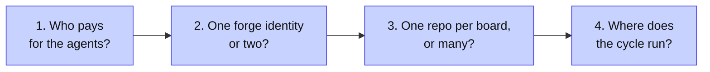

# 2. Choose your setup

Make four decisions before you install. Each one is a binding value or an `init` flag, so you can
change it later.

## 1. Who pays: the profile

| `profile` | Pick it when | Agents run on | Identities |
|---|---|---|---|
| `individual` | One person or a small team on agent subscriptions. | Subscriptions only. No API key. | One (default) |
| `individual-api` | As individual, plus some stages on managed agents or bots. | Subscriptions, plus API keys for those stages. | One (default), or two |
| `organization` | A team that pays per use and wants runs owned by service accounts. | API keys and managed agents. | Two (required) |

Set it with `init --profile 
`. The runner refuses `ANTHROPIC_API_KEY` under both individual
profiles, because that key would bill the cycle to the API.

## 2. One forge identity or two

`forge.review_identity` decides it.

| | One identity (default for individual) | Two identities (required for organization) |
|---|---|---|
| Accounts | Yours. On a Claude cloud routine, the routine's GitHub login. | An implementer account and a separate review app. |
| Who reviews | `review-pr` in the cycle, as a fresh subagent. | `review-pr` in a separate review run that holds the review token. |
| Review status | CI posts it from the review report. | The review app posts it, and approves the change. |
| Human approval of a Full-lane change | A collaborator approves it, or you merge it as admin. | A human approves the head. |
| What it proves | The review is a separate agent context. | No implementer can approve its own change. |

## 3. One repo or many

| Setup | Board | Binding |
|---|---|---|
| One repo | The repo's issues (`github-issues`), or its own Jira project, Linear team or GitHub Project. | Nothing extra. |
| Many repos, one GitHub Project | One Project. | Each repo sets its own `board.options.repo`. |
| Many repos, one Jira project, Linear team or hub repo | One shared board. | Each repo sets `board.scope.label: repo:<name>`. One repo sets `home: true` and lists every label in `repos`; it triages new work to a repo. |

Every repo has its own install, binding, cycle and pinned version.

## 4. Where the cycle runs

| Runtime | Pick it when | Limits |
|---|---|---|
| Claude cloud routine | You want no machine of your own; subscription usage. | Board: `github-issues`, Jira or Linear (not a GitHub Project). No Docker: `commands.verify` runs in CI. At most hourly. |
| GitHub Actions | Any board, a GitHub Project included. | A subscription token or an API key in a secret. |
| Your own machine | Code, tools or a network only your machine reaches. | No sandbox: opt in with `sandbox: local` and `AGENTIC_SDLC_LOCAL=1`. The machine must be on. |
| Managed agents | `individual-api` or `organization`. | API billing. |

The templates are in [`templates/runner/`](../../templates/runner/routine.md). Gates run in CI
whatever the runtime.

## Who owns what

| Team shape | `owners` | `forge.human_approval` | Notes |
|---|---|---|---|
| Solo | You are product, factory and bot. | `full-lane` | One identity: you merge Full-lane changes as admin. |
| Small team | Product: the lead. Factory: a second engineer. | `full-lane` | A second person approves Full-lane changes. |
| Organization | Product: a product role. Factory: a platform team. | `always` | Two identities; a human approves every product change. |
| Non-developer owner | Product: the owner. Factory: a technical steward. | `full-lane` or `always` | The owner acts only through board comments and Idea moves. |

## What your product ships

The skills are the same for every product. The binding says what an environment and a proof are.

| Product | `product.environments` | `product.delivery` | Typical proofs |
|---|---|---|---|
| Web service, continuous | `[staging, production]` | continuous | test, visual, computer-use |
| Web product with approved releases | `[staging, production]` | release-line | test, visual, computer-use |
| Mobile app | `[internal, beta, store]` | release-line | test, visual, manual |
| Library or package | `[registry]` | continuous | test |
| Data pipeline or ML model | `[staging, production]` | continuous | eval, data-check |
| Docs or content site | `[production]` | continuous | visual, manual |

Next: [3. Install](3-install.md).
