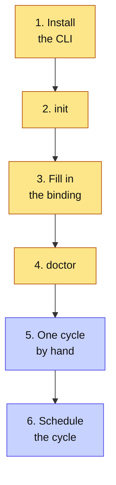

# 3. Install



## Try it first, with no accounts

The `local` board is a file, `.agents/board.json`. No board account and no forge are needed.

```bash
mkdir try-agentic && cd try-agentic && git init -b main && npm init -y
npm i -D --allow-git=root github:dmitriywind/agentic-sdlc#v2.0.0-alpha.5
npx --no agentic-sdlc init --board local --forge github --harness generic
printf 'Show a greeting on the home page.\n' > body.md
npx --no agentic-sdlc board create --title "Greeting" --body-file body.md --status Backlog
npx --no agentic-sdlc dispatch shape --ticket 2
```

`dispatch` prints the instruction your agent would follow and starts nothing. Open the folder in
your agent and ask it to run the `sdlc` skill for one cycle.

## Install on a real repo

1. Install the CLI as a devDependency, pinned to a tag:
   `npm i -D --allow-git=root github:dmitriywind/agentic-sdlc#v2.0.0-alpha.5`.
   It installs from Git only. Warning: the npm package `agentic-sdlc` is a different project.
2. Run `init` with your choices from [chapter 2](2-choose.md), for example:
   `npx --no agentic-sdlc init --profile individual --harness claude --board github-issues`.
   For a Claude cloud routine, add `--no-plugin`: a cloud session loads `.claude/skills/`, not plugins.
3. Fill in `.agents/binding.yml`. The file documents every key. Set at least the owners,
   `commands.*`, `product.environments`, `product.delivery` and `models`.
4. Write the two docs the skills judge every ticket against: `paths.importance_doc` (what matters)
   and `paths.guiding_narrative` (where the product goes). Without them, product questions become holds.
5. Run `npx --no agentic-sdlc doctor` until every port is ok. Import `.github/rulesets/trunk.json` in the
   repo settings. A private repo on GitHub Free cannot enforce a ruleset; `doctor` warns about it.
6. Create the heartbeat ticket on the board and put its id in `heartbeat.ticket`.
7. Put two or three real tickets in Backlog. Run one cycle by hand and read every comment it writes.
   Repeat until three cycles in a row need no correction.
8. Schedule the cycle from [`templates/runner/`](../../templates/runner/routine.md), and the
   dead-man check (`agentic-sdlc ledger stale --max-hours <h>`).

Done when a scheduled cycle writes a heartbeat with no `errors` and a change request merges through the gates.

`init` flags: `--profile`, `--harness` (`claude`, `codex`, `cursor`, `generic`), `--board`
(`github`, `github-issues`, `jira`, `linear`, `local`), `--forge github`, `--vcs git`, `--force`
(overwrite files `init` keeps; it also overwrites the binding), `--no-plugin`. The init log lists
every file it wrote. The per-harness setup is in [docs/ecosystems/](../ecosystems/claude-code.md).

## Claude Code plugin

For Claude Code the skills, the guard hook and the MCP server ship as a plugin, named
`/agentic-sdlc:<skill>`:

```text
/plugin marketplace add dmitriywind/agentic-sdlc
/plugin install agentic-sdlc@agentic-sdlc
```

A scheduled run loads the repo's pinned copy instead: `claude --plugin-dir ./node_modules/agentic-sdlc`.

## Upgrade

1. Read `git log v<yours>..v<new>` and the contract diff.
2. Run `npm uninstall agentic-sdlc`, then the `npm i` line with the new tag. npm 12 refuses to change
   a Git dependency in place (`EALLOWGIT`).
3. Run `init` again without `--force`. It keeps your files and logs what it skipped.
4. Run `validate` and `doctor`, then one cycle by hand.

## Move from a hand-made process

1. List what the old process does that the skills do not. Each item becomes a binding value, a doc
   that `paths.importance_doc` points to, or a gap to report upstream.
2. Copy the old values into the binding.
3. Delete the old copies of the skills. A project replaces the binding, never the skills.

## Recommended around the factory

The factory enforces only its gates and the binding. These help it:

- Repo: trunk rulesets as code, secret scanning with push protection, Actions and dependencies
  pinned by digest, signed release tags, a `SECURITY.md` with a contact.
- Board: work-in-progress limits on In progress and In review, a view of held tickets
  (`needs-human`), an aging view, and a time limit for triaging Signals.
- Operations: service-level objectives with an error budget, release evidence (`product.evidence`:
  SBOM, provenance, signatures; enforced by the release ready check), blameless postmortems whose
  actions return to the Backlog.

Next: [4. A ticket's journey](4-a-ticket.md).
