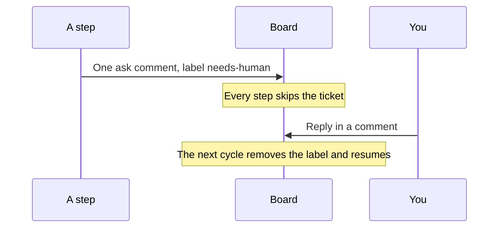

# 3. Your part
<!-- group: Understand -->

The factory asks you only when a rule says so. Each ask is one comment on the issue or the pull
request, and the ticket gets the `needs-human` label (a **hold**). Try a hold below: a step stops,
asks, and the ticket resumes after your reply.

<!-- viz: hold -->

## Every ask you can get

| You get | You do |
|---|---|
| An ask on a ticket (`needs-human`) | Reply in a comment. The next cycle releases the hold. |
| A Full-lane pull request waiting for approval | Look at the change, then add the `approved` label (`forge.approval_label`) to the pull request. |
| A factory change (class `guardrail`) | The same: review it, then add the `approved` label. |
| A `manual` criterion to confirm | Reply that you checked it on this version. |
| A release to approve (release-line delivery only) | Reply to the proposal, then approve the release workflow run. |

The approval label counts only for the commit you looked at: every push removes it, and a label
added before the latest push does not count. The agent cannot add it: the guard hook and the CLI
refuse. It counts only when the account that added it is an owner and is not in `owners.bots`
([the approval feature](../../features/gates/approval.feature), [the guard feature](../../features/guard/push-guard.feature)).

## Who you are

The binding names you in three roles:

| Setting | Means |
|---|---|
| `owners.product` | You decide the product: ideas, priorities, P0, Full-lane approvals. |
| `owners.factory` | You own the skills, the binding and the checks, and approve factory changes. |
| `owners.bots` | The account the factory acts as. In a cloud routine that is your own GitHub login. |

**One account in every role.** Your replies still count, since a reply carries no factory marker.
But GitHub refuses your review of a pull request your account opened, and the gate ignores a label
from an account in `owners.bots`. So nothing can approve a Full-lane or factory change. `validate`
warns, and `status` puts the decision on your list: add a second GitHub account of yours to
`owners.product` and `owners.factory` and approve with it, or set `forge.human_approval: never` so
Full-lane changes merge on the agent review. A factory change then still waits for an approval: you
merge it yourself on GitHub, as the repo admin the trunk ruleset lets bypass.

Optional roles (`owners.operator`, `owners.security`, `owners.compliance`) take asks of their kind;
without them those asks come to you.

## A day from the phone

- **Morning.** GitHub notifications show new asks. Filter the issues on `needs-human`; reply to each.
- **A pull request waits.** Open it in the GitHub app, read the diff and the review comment, add the
  `approved` label (from an owner account outside `owners.bots`, see above).
- **An idea.** New issue with the **Signal** form. It is triaged on the next cycle. A thought you want
  to keep but not start: label it `status:Ideas`.
- **What is going on?** In a Claude Code session on the repo, ask what waits on you. The `setup` skill
  answers from `agentic-sdlc status`: holds, approvals, the next cycle, the last heartbeat, what is
  broken ([the status feature](../../features/cycle/status.feature)). Not yet tried in a cloud session
  from a phone.
- **Silence.** If no cycle ran in time, the dead-man check files a Signal, and GitHub notifies you.

Next: [4. The cycle](4-the-cycle.md).
