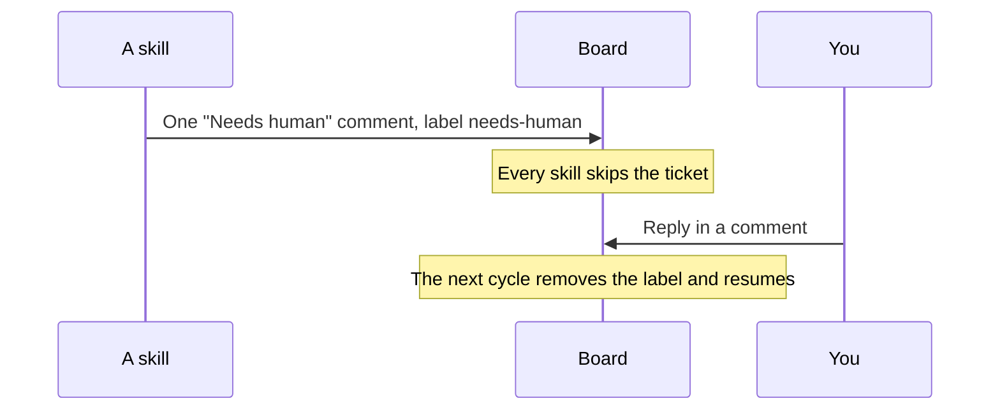

# 3. Your part
<!-- group: Understand -->

The factory asks a person only when a rule says so. Each ask is one comment that you answer on the
ticket or on the pull request. Try a hold below: a skill stops, asks, and resumes after your reply.

<!-- viz: hold -->

## Every ask you can get

| You get | From | You do |
|---|---|---|
| A "Needs human" comment on a ticket | `escalate`, inside any step | Reply in a comment. |
| A request to approve a Full-lane change | `escalate`, when `forge land` reports that a person must approve | Approve the pull request's latest commit, and reply on the ticket. |
| A request to confirm a `manual` criterion | `review/review` | Reply that you checked it on this version. |
| A release ready for approval | `ship` | Reply to the proposal, then approve the release workflow run. |
| A factory change of class `guardrail` | `learn/improve` | Review and approve it as the factory owner. |
| A question about an unclear idea | `plan/groom` | Answer it, or leave the ticket in Ideas. |

## Who you are

| Role | Setting | Acts through |
|---|---|---|
| Product owner | `owners.product` | Ideas, Priority and P0, answers to holds, Full-lane and release approvals. |
| Factory owner | `owners.factory` | The settings, the skills and the checks; approves `guardrail` factory changes. |
| The factory | `owners.bots` | The cycle and the review run. Only these accounts' heartbeats count. |
| Operator, security, compliance | `owners.operator`, `owners.security`, `owners.compliance` | Optional. Deploy and incident asks, security findings, release evidence gaps. With no such role, the ask goes to the product or factory owner. |
| Anyone else | | A pull request like any other, through the same checks. A Signal or `SECURITY.md` to report. |

Each owner setting takes one account or a list. Any account in the list counts as the owner: any factory owner's approval passes a `guardrail` change, and a reply from any of them settles a hold. A reply from an account in `owners.bots` never does. The first account is the primary, the one an ask is addressed to.

## A week with it

**Product owner**
- Put ideas in Ideas; move the ones you want to Backlog.
- Answer holds: filter the board on the `needs-human` label.
- Approve Full-lane pull requests and releases.
- Set P0 only with evidence of production impact.

**Factory owner**
- Read the heartbeats; act when `errors` repeat.
- Watch the dead-man check (`ledger stale`): it fails when no cycle ran in time.
- Review `guardrail` factory changes from the learning loop.
- Upgrade one repo at a time ([9. Run it](9-run-it.md)).

Next: [4. The cycle](4-the-cycle.md).
