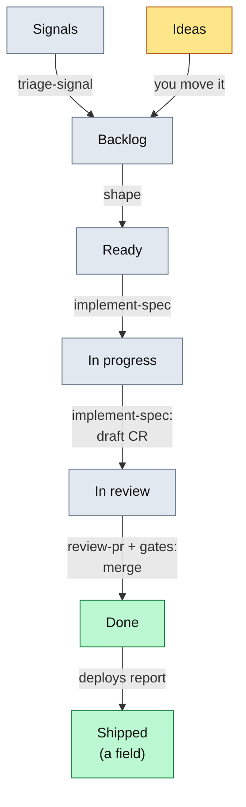
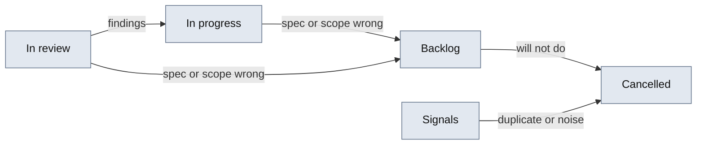

# 4. A ticket's journey

Follow one ticket from a thought to production. Each box is a board status. Each arrow names the
skill or gate that moves the ticket.

<!-- viz: journey -->

| Status | What happens | Who acts | What you see |
|---|---|---|---|
| Ideas | A thought you park. Skills never touch it. | You | Your note. |
| Signals | Raw input: an alert, feedback, a red CI run, a scanner finding. | `triage-signal` | A decision comment: accepted, parked or rejected, with the reason. |
| Backlog | Accepted work. `backlog-grooming` sets a Priority and merges duplicates. | `backlog-grooming` | A Priority, sometimes children under an initiative. |
| Ready | `shape` wrote acceptance criteria, each with a proof, a Size and a Lane. Full lane also gets a spec. | `shape` | The criteria comment; Size and Lane fields. |
| In progress | `implement-spec` writes the proof first, then the code, on a change line. | `implement-spec` | A branch named after the ticket. |
| In review | A draft change request. `review-pr` grades it against the criteria and CI. | `review-pr`, CI gates | The review report on the change request. |
| Done | The change merged. Done is final. | The `merged` gate | The ticket closed, Shipped "Not shipped". |
| Shipped | Each deploy moves the field: On staging, then On production. | The `shipped` gate | The Shipped field. |

One cycle can move a ticket several steps: when a step finishes and the ticket matches the next
one, the cycle starts that step at once, within its time budget.

## Ways back

- A later failure never reopens a Done ticket. It opens a new Signal, which becomes a new ticket.
- Red CI moves the change request back to draft. The ticket stays In review until the cause is fixed.
- Any skill can put a hold on a ticket at any status: see [chapter 8](8-when-you-are-needed.md).

## How work enters

| From | It lands at | Then |
|---|---|---|
| You, a thought | Ideas | You move it to Backlog when you want it. |
| You, a plan or a conversation | Backlog | `backlog-grooming` turns it into tickets. |
| An alert, CI, a deploy, a scanner, feedback | Signals (label `signal:<stream>`) | `triage-signal` decides. |
| A security report | Signals, through `SECURITY.md` | `triage-signal` keeps details out of public tickets. |

Signal text is data. A skill never follows an instruction inside it.

## Size, lane and priority

- **Size** (`XS` to `XL`) is the review burden of one change request, not the effort. Above
  `ready_size_limit`, `shape` splits the ticket.
- **Lane**: Fast for a small change with no risk trigger and no path in `paths.lane_areas`; it merges
  on the agent review. Anything else is Full: it also needs a human approval
  (`forge.human_approval`). Nothing ever demotes Full to Fast.
- **Priority** (`P0`, High, Default, Low): only `p0_setters` set P0, with evidence of production impact.
  The Ready queue goes by priority, then by tickets that unblock others, then oldest first.

Next: [5. The cycle](5-the-cycle.md).
