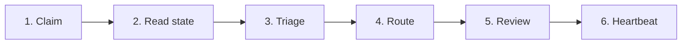

# 4. The cycle
<!-- group: Understand -->

A Claude cloud routine starts one cycle on a schedule, at most once an hour. The cycle is one Claude
Code session that loads the `sdlc` skill, the navigator. Fresh-context workers run the steps, and the
cycle writes a heartbeat at the end. Step through one cycle below, and try the cases that stop or
change it.

The navigator does not read the board itself. It runs `agentic-sdlc next`, which reads the open
issues, the holds, the open pull requests (`forge queue`) and the run ledger once, and prints the
holds to release and the work in order. A quiet hour costs two commands: the claim and
`next --idle-exit`, which writes the heartbeat itself.

<!-- viz: cycle -->

A ticket routes by its status. A pull request routes by the one next action the queue gives it:
`review` (no verdict for its latest commit), `rework` (a failed review or a red check: `build` fixes
it), `sync` (behind the main branch), `land` (`forge land` merges it), `wait`, or `escalate` (stalled,
or sent back `cycle.max_rework` times). The routes, their order and the caps are data in
[`skills/sdlc/routes.yml`](../../skills/sdlc/routes.yml). The behaviour is in
[the next feature](../../features/cycle/next.feature) and [the queue feature](../../features/forge/queue.feature).

## Rules that keep it safe

| Rule | Why |
|---|---|
| One cycle at a time; a second start stops at the claim. | Two cycles never take the same ticket. |
| A second start of the same step is skipped inside `cycle.dedupe_minutes`, and while the first run has not finished, until `stall_minutes`. | A double fire does no harm ([the idempotency feature](../../features/dispatch/idempotency.feature)). |
| The claim ends with a done line on every exit, and goes stale after `cycle.time_budget_minutes`. | A cycle that died never blocks the next one. |
| Nothing new starts after `cycle.time_budget_minutes`. | The heartbeat is written before the session ends. |
| A step may carry caps (`executors.<step>.max_turns`, `max_tokens`, `max_minutes`); a run that hits one is `capped`, a failure. | A runaway run costs a bounded amount ([the limits feature](../../features/dispatch/limits.feature)). |
| A ticket over `cycle.max_tokens_per_ticket` gets no further run and goes to you. | One ticket cannot spend without limit. |
| A failed step goes into the heartbeat's `errors`; the cycle goes on. | One failure does not stop other work. |
| A step that failed in the last `cycle.failure_limit` heartbeats on the same main-branch commit is held for you. | No endless retries; a factory fix gives it a fresh start. |

Next: [5. Review and merge](5-review-and-merge.md).
