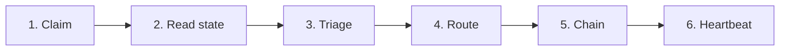

# 4. The cycle
<!-- group: Understand -->

A scheduler starts one cycle at a time, for example every hour. The cycle is one agent session that
loads the `sdlc` skill: it decides the order of work, subagents do the work, and it writes a
heartbeat at the end. Step through one cycle below, and try the cases that stop or change it.

<!-- viz: cycle -->

The routing order and every rule of the cycle are in [`skills/sdlc/SKILL.md`](../../skills/sdlc/SKILL.md).

## Rules that keep it safe

| Rule | Why |
|---|---|
| One cycle at a time; a second start stops at Claim. | Two cycles never claim the same ticket. |
| A second start of the same step inside `cycle.dedupe_minutes` is skipped. | A scheduler that fires twice does no harm. |
| Nothing new starts after `cycle.time_budget_minutes`. | The heartbeat is always written before the job times out. |
| A failed step goes into the heartbeat's `errors`; the cycle goes on. | One failure does not stop other work. |
| A step that failed in the last `cycle.failure_limit` heartbeats on the same main-branch commit is held for a person. | No endless retries; a fix to the factory gives the step a fresh start. |

Next: [5. Review and merge](5-review-and-merge.md).
