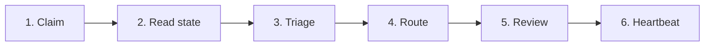

# 4. The cycle
<!-- group: Understand -->

A scheduler starts one cycle at a time, for example every hour. The cycle is one agent session that
loads the `sdlc` skill, the navigator: it decides the order of work, fresh-context workers run the
steps, and it writes a heartbeat at the end. Step through one cycle below, and try the cases that
stop or change it.

The navigator does not read the board itself. It runs `agentic-sdlc next`, which reads the board, the
held tickets (`board holds`), the open pull requests (`forge queue`) and the run ledger once and
prints the holds to release and the work in order. A quiet hour costs two commands: the claim and
`next --idle-exit`, which writes the heartbeat itself. At the end `ledger heartbeat` writes the
heartbeat and the line that ends the claim. A ticket routes by its status. A pull request routes by the one next action
the queue gives it: `review` (no verdict for its latest commit), `rework` (a failed review or a red
check: `build` fixes it), `sync` (behind the main branch), `land` (`forge land` merges it), `wait`
or `escalate` (stalled, or sent back `cycle.max_rework` times).

<!-- viz: cycle -->

The routes, their order and the caps are data in [`skills/sdlc/routes.yml`](../../skills/sdlc/routes.yml);
the steps of the cycle are in [`skills/sdlc/SKILL.md`](../../skills/sdlc/SKILL.md). The behaviour is in
[`features/cycle/next.feature`](../../features/cycle/next.feature).

## Rules that keep it safe

| Rule | Why |
|---|---|
| One cycle at a time; a second start stops at Claim. | Two cycles never claim the same ticket. |
| A second start of the same step is skipped inside `cycle.dedupe_minutes`, and while the first run has not finished until `stall_minutes`. | A scheduler that fires twice does no harm; keep `stall_minutes` above your longest stage run. |
| A cycle's claim ends with its done line on every exit (idle, holds only, failed), and goes stale after `cycle.time_budget_minutes` if the cycle died first. | A cycle that only held tickets never blocks the next one. |
| Each cycle releases the hold (`board release`) on a ticket whose owner has replied. | An owner who only comments is never stuck. |
| Nothing new starts after `cycle.time_budget_minutes`. | The heartbeat is always written before the job times out. |
| A stage may carry caps (`executors.<stage>.max_turns`, `max_tokens`, `max_minutes`); a run that ends on one is recorded `capped` and treated as a failed run. | A runaway run costs a bounded amount. |
| A ticket whose runs used more than `cycle.max_tokens_per_ticket` tokens gets no further run and goes to a person. | One ticket cannot spend without limit; `ledger summary` lists tokens per ticket. |
| A failed step goes into the heartbeat's `errors`; the cycle goes on. | One failure does not stop other work. |
| A step that failed in the last `cycle.failure_limit` heartbeats on the same main-branch commit is held for a person. | No endless retries; a fix to the factory gives the step a fresh start. |

Next: [5. Review and merge](5-review-and-merge.md).
