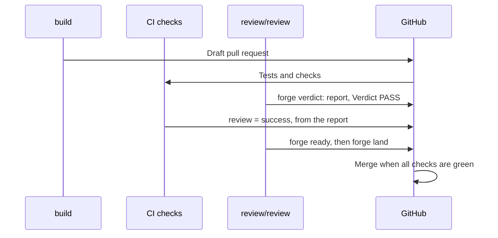

# 5. Review and merge
<!-- group: Understand -->

`build` opens a **draft** pull request. CI and `review/review` then decide whether it merges. The
review never runs the change's code: CI runs it, with no secrets, and the review reads the result.
It publishes one verdict for the latest commit with `forge verdict`. On a pass it marks the pull
request ready and calls `forge land`, the only way anything merges: it waits for the required checks,
then turns on auto-merge, or reports who must approve. Switch the lane (Fast or Full) and the accounts
(one, or a separate review account) below to see what changes.

<!-- viz: review -->

## One account

The factory acts on GitHub as one account, yours. The review is a fresh agent context with no edit
tools that may run only `agentic-sdlc` commands, not a second account. `forge verdict` posts the
report; the CR workflow's `review` gate turns it into the `review` status
([the review gate feature](../../features/gates/review.feature)). So the branch rules cannot prove that
an agent did not post its own review. A separate review account (`forge.review_identity`, profile
`organization`) closes that gap; this guide does not cover it, the contract does.

## The six required checks

| Check | Passes when |
|---|---|
| `Required` | `commands.install` and `commands.verify` pass on the change, in a job with no secrets. |
| `proofs-on-base` | Every new or changed proof fails on the old code, so it proves the change ([feature](../../features/gates/proofs-on-base.feature)). |
| `ticket-linkage` | The pull request closes exactly one open ticket, named in its branch ([feature](../../features/gates/linkage.feature)). |
| `review` | The review verdict for the latest commit is PASS. |
| `human-approval` | The approval its class needs is on the latest commit (below). |
| `skill-regression` | A factory change keeps the skill pack valid. A product change passes it. |

A seventh, `agent-provenance`, is off until you set `forge.provenance`: it lists each commit as agent
or human from `Agent-Run` and `Agent-Model` trailers ([feature](../../features/gates/provenance.feature)).

## Who must approve

| Class | Is | Needs |
|---|---|---|
| `product-fast` | A product change in the Fast lane. | Nothing more. |
| `product-full` | A Full-lane change, or one that touches `paths.lane_areas`. | An approving review by a collaborator outside `owners.bots`, or the approval label from `owners.product`, unless `forge.human_approval: never`. |
| `tuning` | A factory change to the model map, or to the tier of a skill with a bench suite. | Nothing when `learning.auto_merge_classes` lists it; else as `guardrail`. |
| `guardrail` | Any other factory change, or one that mixes product and factory files. | An approval or the approval label from `owners.factory`. |

Who may add the label, and what that means with one account, is in [3. Your part](3-your-part.md)
([the classify feature](../../features/gates/classify.feature)).

## When review says no

| Finding | Where it goes |
|---|---|
| A criterion not met, a bug, a security issue | A fail verdict. The queue says `rework`: `build` fixes each finding and pushes. After `cycle.max_rework` reworks, you are asked. |
| The spec or scope is wrong | The pull request goes back to draft; the ticket goes to Backlog. |
| A pull request you opened | `build` never pushes to it: a note gives you the findings. |
| A red check | `rework`. A cause in the change: `build` fixes it. A cause elsewhere becomes a Signal, and the pull request waits until it closes. |
| Behind the main branch | `sync`: brought up to date, then reviewed again. |
| A check pending past `stall_minutes` | `escalate`: you are asked. |

A private repo on GitHub Free has no draft pull requests and no enforced ruleset: a draft is a pull
request with the `draft` label, and the merge happens once every required check is green, with no
rule to stop it. `doctor` warns ([the cloud feature](../../features/forge/cloud.feature)).

Next: [6. Shipping](6-shipping.md).
