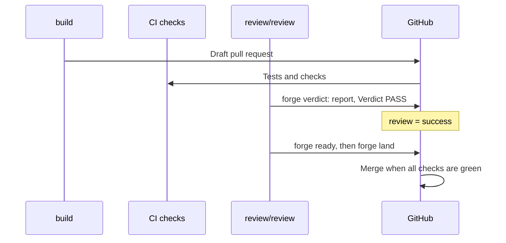

# 5. Review and merge
<!-- group: Understand -->

`build` opens a **draft** pull request. CI and `review/review` then decide whether it merges.
The review never runs the change's code: CI runs it, with no secrets, and the review reads the
result. It publishes one verdict for the latest commit with `forge verdict`. On a pass it marks the
pull request ready and calls `forge land`, the only way anything merges: it waits for the required
checks, then turns on auto-merge, or reports who must approve. Switch between one and two
identities, and between the Fast and Full lane, to see what changes.

<!-- viz: review -->

## One identity or two

The factory acts on GitHub as one account or two. `forge.review_identity` decides it, and you
pick it once, in [7. Choose your setup](7-choose.md). The skills are the same in both: the CLI does
what differs.

| | One identity | Two identities |
|---|---|---|
| Accounts | Yours. | An implementer account and a separate review app. |
| Where the review runs | In the cycle, as a fresh agent context. | In a separate review run, the only one that holds the review token. |
| The `review` status | CI posts it from the report. | `forge verdict` posts it as the review app, with an approving review. |
| A Full-lane approval | A collaborator approves the latest commit, or you merge as admin. | A human approves the latest commit. |

The trade-off is real. With one identity the review is a separate context, not a separate account,
so the branch rules cannot prove that an agent did not post its own `review` status. With two, no
implementer can post that status or approve its own change.

## The six required checks

| Check | Passes when |
|---|---|
| `Required` | `commands.install` and `commands.verify` pass on the change, in a job with no secrets. |
| `proofs-on-base` | Every new or changed proof fails on the old code, so it proves the change. |
| `ticket-linkage` | The pull request closes exactly one open ticket, named in its branch. |
| `review` | The review verdict is PASS. |
| `human-approval` | The approvals its class needs are on the latest commit (below). |
| `skill-regression` | A factory change keeps the skill pack valid. A product change passes it. |

## Who made each commit

A seventh check, `agent-provenance`, is off until you set `forge.provenance`. When it is on, every commit an agent makes ends with `Agent-Run` and `Agent-Model` trailers, and the pull request body lists the run ids. The check reads the commits of the pull request and lists each as agent or human. A merge made by the forge's own account, such as a branch update, is listed as a merge. A merge commit by anyone else is checked like any other commit. With `warn` it only reports. With `require` it fails when an agent commit has no trailers, and you add it to the required checks yourself. A squash merge keeps one commit, so the check's report on the pull request is the record. [docs/forges.md](../forges.md) maps the checks to the SLSA Source track.

## Who must approve

| Class | Is | Needs |
|---|---|---|
| `product-fast` | A product change in the Fast lane. | Nothing more. |
| `product-full` | A product change in the Full lane, or one that touches `paths.lane_areas`. | A human approval (`forge.human_approval`). |
| `tuning` | A factory change to the model map or a benched skill's tier. | Nothing, when `learning.auto_merge_classes` lists it; else the factory owner. |
| `guardrail` | Any other factory change. | The factory owner. |

## When review says no

Each open pull request gets one next action from `forge queue`; the cycle acts on it.

| Finding | Where it goes |
|---|---|
| A criterion not met, a bug, a security issue | A fail verdict. The queue says `rework`: `build` sends the ticket back to In progress, fixes each finding and pushes. After `cycle.max_rework` reworks, a person is asked. |
| The spec or scope is wrong | The pull request goes back to draft; the ticket goes to Backlog. |
| A pull request a person opened | `build` never pushes to it: a note gives that person the findings. |
| A red check | The queue says `rework`. A cause in the change: `build` fixes it. A cause elsewhere becomes a Signal, and the pull request waits until it closes. |
| It is behind the main branch | The queue says `sync`: it is brought up to date, and the new commit is reviewed again. |
| A check stays pending past `stall_minutes` | The queue says `escalate`: a person is asked. |

GitHub setup (rulesets, tokens, private repos on GitHub Free) is in [forges.md](../forges.md).

Next: [6. Shipping](6-shipping.md).
