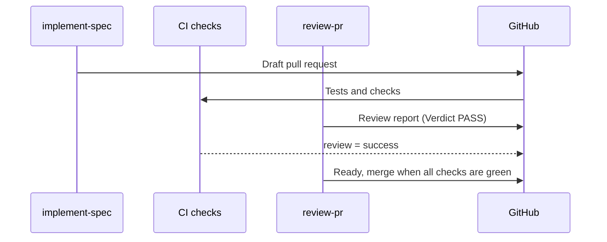

# 5. Review and merge
<!-- group: Understand -->

`implement-spec` opens a **draft** pull request. CI and `review-pr` then decide whether it merges.
The review never runs the change's code: CI runs it, with no secrets, and the review reads the
result. Switch between one and two identities, and between the Fast and Full lane, to see what changes.

<!-- viz: review -->

## The six required checks

| Check | Passes when |
|---|---|
| `Required` | `commands.install` and `commands.verify` pass on the change, in a job with no secrets. |
| `proofs-on-base` | Every new or changed proof fails on the old code, so it proves the change. |
| `ticket-linkage` | The pull request closes exactly one open ticket, named in its branch. |
| `review` | The review verdict is PASS. |
| `human-approval` | The approvals its class needs are on the latest commit (below). |
| `skill-regression` | A factory change keeps the skill pack valid. A product change passes it. |

## Who must approve

| Class | Is | Needs |
|---|---|---|
| `product-fast` | A product change in the Fast lane. | Nothing more. |
| `product-full` | A product change in the Full lane, or one that touches `paths.lane_areas`. | A human approval (`forge.human_approval`). |
| `tuning` | A factory change to the model map or a benched skill's tier. | Nothing, when `learning.auto_merge_classes` lists it; else the factory owner. |
| `guardrail` | Any other factory change. | The factory owner. |

## When review says no

| Finding | Where it goes |
|---|---|
| A criterion not met, a bug, a security issue | The ticket goes back to In progress with the findings, until `cycle.max_rework` reports have asked for it; then a person is asked. |
| The spec or scope is wrong | The pull request goes back to draft; the ticket goes to Backlog. |
| A pull request a person opened | Back to draft with the report; that person fixes it. |
| A red check | Back to draft. A cause in the code goes to In progress; a cause elsewhere becomes a Signal. |
| It is behind the main branch | It is brought up to date and reviewed again. |

GitHub setup (rulesets, tokens, private repos on GitHub Free) is in [forges.md](../forges.md).

Next: [6. Shipping](6-shipping.md).
