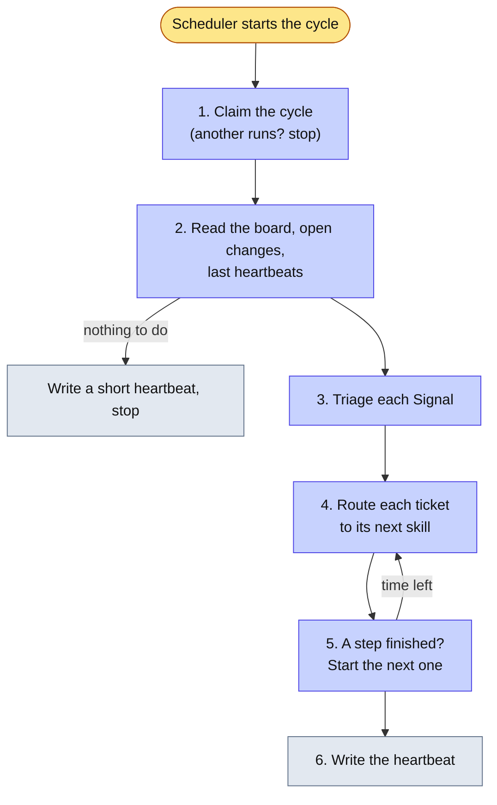

# 5. The cycle

A scheduler starts one cycle at a time, for example every hour. The cycle is one agent session
that loads the `sdlc` skill. It decides the order of work; subagents do the work.

## Route: the order

1. Release requests, and P0 fixes that are ready to release.
2. Change requests a person opened (hand-offs).
3. Tickets In progress (rework, or work that stopped).
4. Ready tickets, from the top, at most `cycle.max_implementations` new ones.
5. Backlog: grooming for tickets with no Priority, then shaping while fewer than `cycle.min_ready` are Ready.
6. Change requests that need a review (with one identity; with two, a separate review run does it).

The full routing table is in [`skills/sdlc/SKILL.md`](../../skills/sdlc/SKILL.md). With learning on,
the cycle also grades the last runs and, every `learning.every_cycles` cycles, proposes one factory
change ([chapter 9](9-learning.md)).

## Rules that keep it safe

| Rule | Why |
|---|---|
| One cycle at a time; a second start stops at step 1. | Two cycles never claim the same ticket. |
| A second dispatch of the same step inside `cycle.dedupe_minutes` is skipped. | A scheduler that fires twice does no harm. |
| Nothing new starts after `cycle.time_budget_minutes`. | The heartbeat is always written before the job times out. |
| A failed step goes into the heartbeat's `errors`; the cycle goes on. | One failure does not stop other work. |
| A step that failed in the last `cycle.failure_limit` heartbeats on the same trunk commit is held for a person. | No endless retries; a factory fix gives the step a fresh start. |

## The heartbeat

Each cycle writes one comment on the heartbeat ticket: when it ran, the trunk commit it read its
skills from, one row per run (skill, ticket, model, outcome) and its errors. The heartbeats are the
run ledger: `agentic-sdlc ledger summary` reads them, and the dead-man check
(`ledger stale --max-hours <h>`) fails when none arrived in time.

Next: [6. Review and merge](6-review-and-merge.md).
