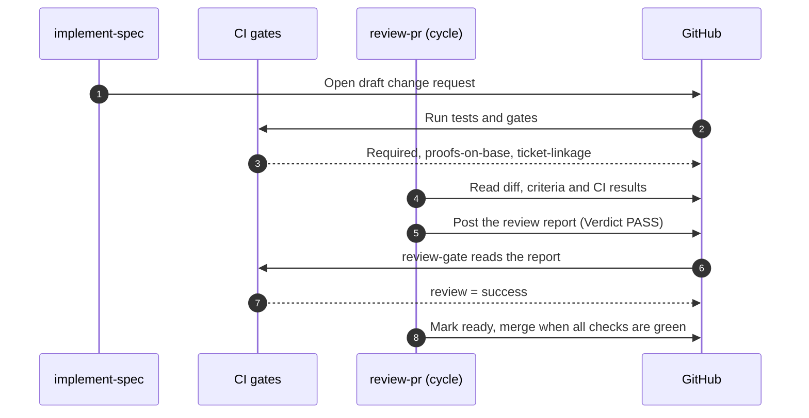
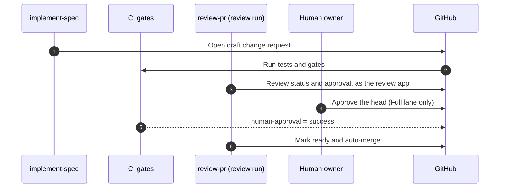

# 6. Review and merge

`implement-spec` opens a **draft** change request. From there, CI and `review-pr` decide whether it
merges. The review never runs the change's code: CI runs it, with no secrets, and the review reads the result.

## With one identity (the individual default)

The factory acts as your account. GitHub refuses an approval from a change's author, so nothing
approves: the `review` status comes from CI, built from the report. A Full-lane change waits until a
collaborator approves it, or until you merge it as admin.

## With two identities (organization)

The review runs in its own scheduled run and is the only run that holds the review token. No
implementer can post `review` or approve its own change.

## The required checks

| Check | Posted by | Passes when |
|---|---|---|
| `Required` | CI job with no secrets | `commands.install` and `commands.verify` pass on the head. |
| `proofs-on-base` | CI gate | Every new or changed proof fails on the merge base (it proves the change). |
| `ticket-linkage` | CI gate | The change closes exactly one open ticket, named in its branch. |
| `review` | `review-pr`, or CI from its report | The review verdict is PASS. |
| `human-approval` | CI gate | The approvals its class needs are on the head (below). |
| `skill-regression` | CI gate | A factory change keeps the skill pack valid. |

| Class | Is | Needs |
|---|---|---|
| `product-fast` | A product change in the Fast lane. | Nothing more. |
| `product-full` | A product change in the Full lane, or one that touches `paths.lane_areas`. | A human approval (per `forge.human_approval`). |
| `tuning` | A factory change to the model map or a benched skill's tier. | Nothing, when `learning.auto_merge_classes` lists it; else the factory owner. |
| `guardrail` | Any other factory change. | The factory owner. |

## When review says no

| Finding | Where it goes |
|---|---|
| A criterion not met, a bug, a security issue | The ticket goes back to In progress with the findings. |
| The spec or scope is wrong | The change goes back to draft; the ticket goes to Backlog. |
| A change a person opened | Back to draft with the report; the person fixes it. |
| A red check | Back to draft. A cause in the code goes to In progress; a cause elsewhere becomes a Signal. |
| The change is behind the trunk | It is synced and reviewed again. |

GitHub specifics (rulesets, tokens, private repos on GitHub Free) are in [forges.md](../forges.md).

Next: [7. Shipping](7-shipping.md).
