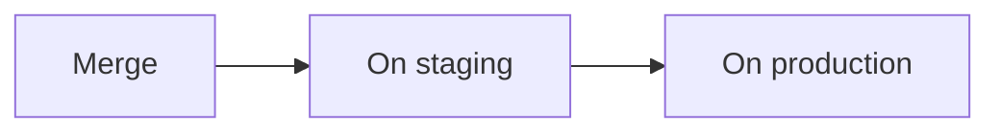

# 6. Shipping
<!-- group: Understand -->

A merge makes the ticket Done and "Not shipped". Your deploy jobs then report each environment to
the `shipped` check, which moves the ticket's **Shipped** field. `product.delivery` picks one of two
ways. Merge, deploy, and make a deploy fail below.

<!-- viz: ship -->

| | Continuous | Release line |
|---|---|---|
| What ships | Every merge, environment by environment. | What the Product owner approves: `ship` proposes the contents and cuts the release line. |
| Who starts a release | Nobody: each deploy reports itself. | You open a release request (a Backlog ticket with the `release` label); a P0 fix opens one by itself. |
| The last environment | Deploys from the main branch. | Deploys from the release line, after your approval. Agents never approve it. |
| Evidence | | With `product.evidence`, the release is ready only when `commands.evidence_check` passes. |

## When a deploy fails

- The tickets in that deploy go back to the last good environment, and one Signal opens with the
  evidence. A failure in the last environment also puts a hold on the Signal.
- A rollback reports `--result rolled-back`: tickets not in the running version step back.
- A failed release line is left as it is. The fix ships under the next version.
- If the delivery workflow itself fails, start it by hand with the commit's sha: it runs the
  `merged` check again.

Next: [7. Choose your setup](7-choose.md).
