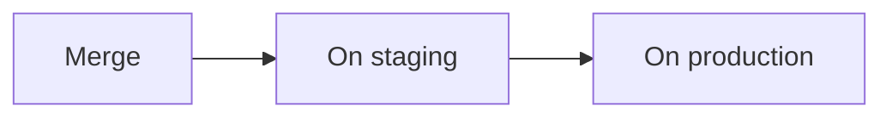

# 6. Shipping
<!-- group: Understand -->

A merge makes the ticket Done and "Not shipped". Your deploy workflows then report each environment
to the `shipped` check, which moves the ticket's **Shipped** field. Merge, deploy, and make a deploy
fail below.

<!-- viz: ship -->

`init` writes `product.delivery: continuous`: every merge ships, environment by environment, from the
main branch. Nobody starts a release. The delivery workflow (`agentic-sdlc-delivery.yml`) watches the
deploy workflows named in `forge.deploy_workflows` and the CI workflow in `forge.ci_workflow`
([the shipped feature](../../features/gates/shipped.feature), [the merged feature](../../features/gates/merged.feature)).

The delivery workflow reports the first and the last deploy under the fixed names `first-env` and
`last-env`, not the names in `product.environments`. Until it reads them, rename those two words in
the installed workflow to your environment names.

## When a deploy fails

- The tickets in that deploy go back to the last good environment, and one Signal opens with the
  evidence. A failure in the last environment also puts a hold on that Signal.
- A rollback reports `--result rolled-back`: tickets not in the running version step back.
- With `product.evidence` set, a last deploy whose `commands.evidence_check` fails counts as failed.
- If the delivery workflow itself fails, run it by hand with the commit's sha: it runs the `merged`
  check again.

## Release lines (opt in)

Set `product.delivery: release-line` when you want to approve what reaches the last environment.
Then the `ship` step proposes the contents of a release when you open a release request (a Backlog
ticket with the `release` label), cuts a release line on your go-ahead, and the release workflow runs
after you approve it in GitHub's Environment `agentic-release`. Agents never approve it.

Next: [7. Install](7-install.md).
