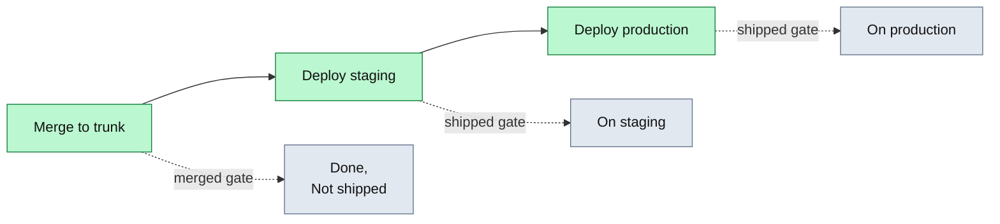
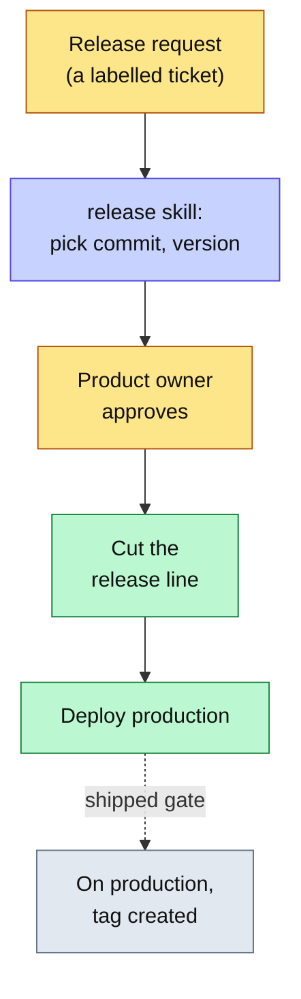
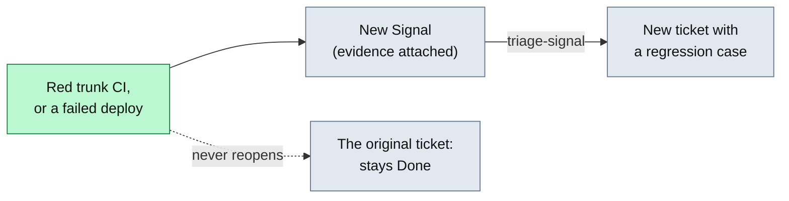

# 7. Shipping

A merge makes the ticket Done and "Not shipped". Your deploy jobs then report each environment
to the `shipped` gate, which moves the ticket's **Shipped** field. `product.delivery` picks one of two ways.

## Continuous: every merge ships

## Release line: the Product owner approves what ships

- You open a release request (a Backlog ticket with the `release` label). A P0 fix on the first
  environment opens one by itself.
- Agents never approve the last environment. On GitHub you approve the release workflow run.
- With release evidence (`product.evidence`), the release is ready only when `commands.evidence_check` passes.

## When something fails

- A failed deploy moves its tickets back to the last good environment and opens one Signal.
- A rollback reports `--result rolled-back`: tickets not in the running revision step back.
- A failed release line is left as it is. The fix ships under the next version.
- If the delivery run itself fails, start the delivery workflow by hand with the commit's sha: it
  runs the `merged` gate again.

Next: [8. When you are needed](8-when-you-are-needed.md).
