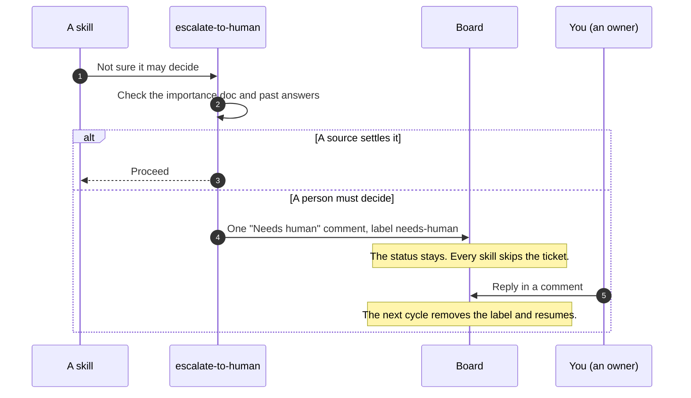

# 8. When you are needed

The factory asks a person only when a rule says so. Each ask is one comment that you answer on the
board or on the change request.

## The hold

A hold is a label, not a status. Your reply counts only when you are in `owners` (a trusted comment).
You need no label rights: the cycle removes `needs-human` after your reply.

What makes a skill ask: an architecture or scope change, something that cannot be undone, security,
personal data, money, a legal duty, a sign-off, missing access or a credential, a product ruling, a
regression, the same failure twice, or a P0.

## Every ask you can get

| You get | From | You do |
|---|---|---|
| A "Needs human" comment on a ticket | `escalate-to-human` | Reply in a comment. |
| A request to approve a Full-lane change | `review-pr` | Approve the head on GitHub, or merge it as admin with one identity. |
| A request to confirm a `manual` criterion | `review-pr` | Reply that you checked it on this head. |
| A release ready for approval | `release` | Approve the release workflow run. |
| A factory change of class `guardrail` | `improve-factory` | Review and approve the change as the factory owner. |
| A question when an idea's outcome is unclear | `backlog-grooming` | Answer it, or leave the ticket in Ideas. |

## Who you are

| Role | Binding | Acts through |
|---|---|---|
| Product owner | `owners.product` | Ideas, Priority and P0, answers to holds, Full-lane and release approvals. |
| Factory owner | `owners.factory` | The binding, the skills and the gates; approves `guardrail` factory changes. |
| The factory | `owners.bots` | The cycle and the review run. Only these accounts' heartbeats count as state. |
| Anyone else | | A change request like any other; the same gates apply. A Signal or `SECURITY.md` to report. |

Next: [9. Learning](9-learning.md).
