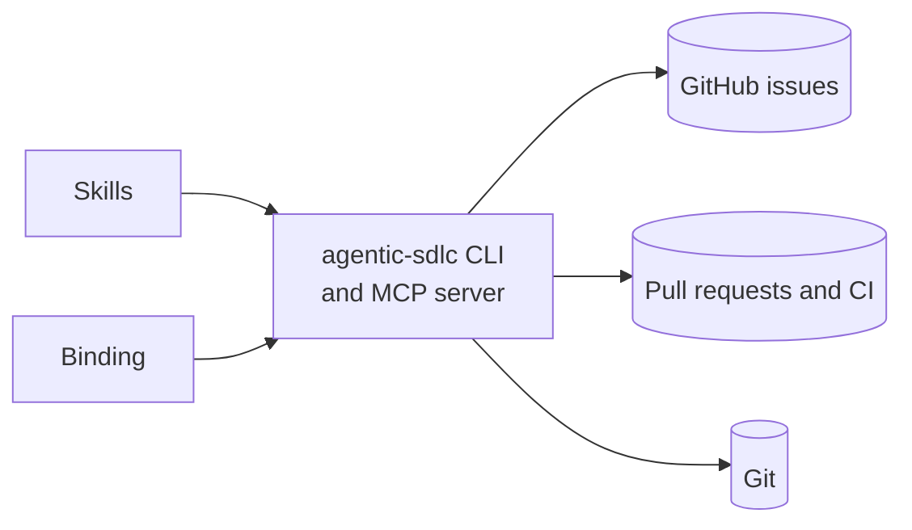

# 9. The parts
<!-- group: Reference -->

How the factory is built. The exact rules are in the contract,
[`references/architecture.md`](../../references/architecture.md).

## Three layers

| Layer | Where | Holds |
|---|---|---|
| Skills | the plugin, and copies in `.agents/skills/` and `.claude/skills/` | The process: every rule. The same for every project. |
| Binding | `.agents/binding.yml` | Your project's values: owners, commands, environments, models. |
| CLI | `agentic-sdlc` and its MCP server | The mechanism: board, forge and Git verbs, the checks, dispatch, the run ledger. |

A project changes only its binding. A skill never calls `gh` or `git` directly: it calls the CLI.

## Seven skills, one per phase

A step is what runs: `dispatch plan/shape --ticket 12`. A skill with one step runs by its name. The
cycle runs every step in a fresh context.

| Skill | Phase | Steps |
|---|---|---|
| `sdlc` | The navigator: one cycle, routing each ticket and pull request to its next step. | one |
| `plan` | Signals, Ideas and Backlog to Ready. | `triage`, `groom`, `shape` |
| `build` | Ready to In review: proof first, then code, then a draft pull request; every rework. | one |
| `review` | In review to merged, or sent back. | `review`; `verify` (uses a preview as a user, for `computer-use` criteria) |
| `ship` | Release lines (release-line delivery only). | one |
| `escalate` | Decides whether you must act, and holds the ticket with one ask. | one, inside the calling step |
| `learn` | The learning loop (`learning.enabled`). | `judge`, `improve` |

`setup` is the eighth skill: it installs and repairs the factory and answers what waits on you. No
cycle runs it. Under the plugin a skill is `agentic-sdlc:<skill>`; a copy is `sdlc-<skill>` (`sdlc`
stays `sdlc`).

## Trust boundaries

| Part | Runs the change's code | Holds secrets |
|---|---|---|
| CI `Required` and `proofs-on-base` jobs | yes | no |
| CI gates | no: the CLI only, with the rules from the main branch | the job token |
| The cycle and `build` | their own work | the routine's GitHub access |
| `review/review` | no: it reads CI results and the diff | the routine's GitHub access |
| `review/verify` | yes: a preview, in a browser | test credentials, only if you give them |

Untrusted input is data, never instructions: Signal text, pull request bodies, and comments by
accounts outside `owners`. The guard hook refuses a push to the main branch and any agent write of the
approval label.

## What `init` puts in your project

| Path | Holds |
|---|---|
| `.agents/binding.yml` | Every project value. |
| `.agents/cli.json`, `.agents/bin/agentic-sdlc` | The CLI pin and the launcher that installs it in `.agents/.cli/` on first use. Every workflow, hook and runner calls the launcher. |
| `.agents/skills/`, `.agents/scorers/` | The skill pack the gates read, and the scorers. |
| `.agents/cycle-prompt.md`, `runner-setup.sh`, `hooks/` | What a scheduler runs; the hook scripts. |
| `.claude/skills/`, `.claude/agents/`, `.claude/settings.json`, `.mcp.json` | What a cloud session loads: the skills, the tier agents and the reviewer, the hooks, the MCP server. |
| `.github/workflows/agentic-sdlc-*.yml`, `.github/rulesets/`, `.github/ISSUE_TEMPLATE/signal.yml` | The checks, the branch protection, the Signal form. |
| `AGENTS.md`, `CLAUDE.md` | A pointer for every agent: start with the `sdlc` skill. |

A change under `.agents/`, `.github/` or `.claude/` is a factory change.

Next: [10. Glossary](10-glossary.md).
