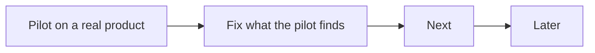

# Roadmap

What comes next for agentic-sdlc, in order. This repo does not run its own factory, so this file
is its backlog. A finished item moves to the CHANGELOG and leaves this file.

## Now

| Item | Why | Done when |
|---|---|---|
| Pilot on a real product repo | v2 has 179 passing tests but has never run against a real product. | Three scheduled cycles in a row write a heartbeat with no `errors`, and a ticket goes from Backlog to Shipped. |

## Next

| Item | Why |
|---|---|
| Owners as lists; optional operator, security and compliance owners | Teams have more than one owner per role. |
| `product.slo` and DORA measures | Error budget pauses feature work; P0 counted as change failure; rework rate. |
| Pin CI actions by SHA; fail when `AGENTIC_SDLC_VERSION` is unset | Mutable refs in gate templates. |

## Later

| Item | Why |
|---|---|
| Scorers for shape quality and triage accuracy | `improve-factory` has no evidence for those two skills. |
| Move the common contract to `skills/sdlc/references/contract.md`; fold `verify-ux` into `review-pr` | Shorter skills, one home per rule. |
| OpenTelemetry GenAI attributes and CDEvents on factory and deploy records | Standard telemetry for agent runs and deploys. |
| `signal-on-red` through a `forge run <id>` verb | Today it searches a window of 30 runs. |
