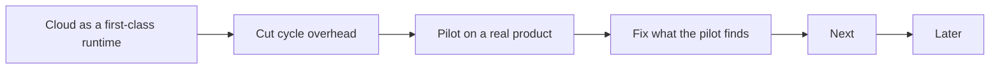

# Roadmap

What comes next for agentic-sdlc, in order. This repo does not run its own factory, so this file
is its backlog. A finished item leaves this file; the git log holds it.

## Now

The factory serves any project. A Claude cloud scheduled task on a subscription is a first-class
runtime, not a fallback. Facts from a probe in a cloud session (2026-11-14) and the Claude Code docs:

- The GitHub proxy rejects every GraphQL call, whatever the token: `gh pr`, `gh issue` and
  Projects v2 fail.
- REST works only under `repos/{owner}/{repo}/…` for the repos attached to the session.
  `orgs/*` and `users/*` are refused, so Projects v2 is unreachable by REST too.
- The proxy serves the GraphQL-only PR actions as REST: `POST pulls/{n}/ccr/ready_for_review`,
  `POST pulls/{n}/ccr/convert_to_draft`, `PUT|DELETE pulls/{n}/ccr/auto_merge`,
  `GET pulls/{n}/ccr/review_threads`.
- The claude.ai GitHub connector works, with the same repo scope, and has no Projects tool.
- At the default network level, `api.linear.app` and `*.atlassian.net` are refused; they need
  the environment's allowed domains.
- Repo plugins do not load. No Docker daemon. A foreground command stops at 10 minutes; a
  background one at 2 hours. Scheduled runs use the same subscription limits as interactive work.

| Item | Why | Done when |
|---|---|---|
| A GitHub board a cloud run can reach | Projects v2 is unreachable from a cloud session by GraphQL, REST and the connector. | A `github-issues` board: Status, Size, Priority, Lane and Shipped as labels, all through `repos/…`. The `github` (Projects v2) board stays for CI runtimes. |
| Jira and Linear from the cloud | Both hosts are refused at the default network level. | The routine template adds the host to the environment's allowed domains and the token as a network secret; one cloud run lists the board. |
| Skills in a cloud session | Plugins from `.claude/settings.json` do not load; `templates/runner/claude-routine.md` says to enable one. | `init --harness claude` can write the skills to `.claude/skills/`; the routine template names that path. |
| Verify out of the agent run | A cloud session has no Docker and stops a foreground command at 10 minutes. | The routine runs `commands.fast_check`; `Required` runs `commands.verify` in CI; the template says so. |
| `doctor` names unenforced gates | On a private GitHub Free repo, rulesets and branch protection return 403, so no gate blocks a merge. | `doctor` warns when the trunk has no enforced ruleset. |
| Cut cycle overhead | An idle cycle still writes a full heartbeat and starts a review session (about 12k tokens); every subagent re-loads the 3.7k-token navigator; the heartbeat holds 17 measures no code reads. | Idle exit; the review fires only for an unreviewed CR; heartbeat `at`, `factory`, `runs`, `errors`; a 1k contract file for step skills; Sonnet as the routine model, Opus for `shape`. |
| Learning loop behind one switch | A subscription reports no cost per run, so the USD fields are always empty. | Learning is off unless enabled; the USD cost fields are gone; the bench stays for API-billed setups. |
| Delete what no runtime test covers | Grok and Antigravity harness files, `mcp --http`, the `tuning` class with no bench. | Each harness the docs list has a test, or it is deleted. |
| Pilot on a real product repo | 179 tests, no run against a real product. | Three scheduled cloud runs in a row write a heartbeat with no `errors`, and one ticket goes from Ready to Done with no hand fix. |

## Next

| Item | Why |
|---|---|
| Owners as lists; optional operator, security and compliance owners | Teams have more than one owner per role. |
| `product.slo` and DORA measures | Error budget pauses feature work; P0 counted as change failure; rework rate. |
| Pin CI actions by SHA; fail when `AGENTIC_SDLC_VERSION` is unset | Mutable refs in gate templates. |

## Later

| Item | Why |
|---|---|
| Scorers for shape quality and triage accuracy | `improve-factory` has no evidence for those two skills. |
| Move the common contract to `skills/sdlc/references/contract.md`; fold `verify-ux` into `review-pr` | Shorter skills, one home per rule. |
| OpenTelemetry GenAI attributes and CDEvents on factory and deploy records | Standard telemetry for agent runs and deploys. |
| `signal-on-red` through a `forge run <id>` verb | Today it searches a window of 30 runs. |
