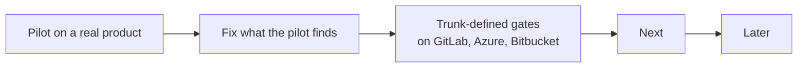

# Roadmap

What comes next for agentic-sdlc, in order. This repo does not run its own factory, so this file
is its backlog. A finished item moves to the CHANGELOG and leaves this file.

## Now

| Item | Why | Done when |
|---|---|---|
| Trunk-defined gates on GitLab, Azure and Bitbucket | The CR's own pipeline file runs the gates there, so its author can change or skip them. | A pipeline the CR cannot change (GitLab pipeline execution policy, Azure required template) holds every gate, or doctor fails for that forge. |
| Implementer token without commit-status write | Code the cycle runs in `npm test` can post a status with raw HTTP. | The profiles and doctor name the permission; `review` and `human-approval` are pinned to the review app. |
| Board and forge identities per owner | A Jira accountId and a GitLab username differ, so one `owners.*` string cannot match both. | `owners.<role>` takes `{ board, forge }`. |
| A CR push time on the port | review-pr and the heartbeat measure "pending longer than `stall_minutes` after the push" with no time on `CR`. | `CR` carries the head's push time. |
| Template heartbeat ticket is a number | `init` writes `heartbeat.ticket: "HEARTBEAT-1"`, which a GitHub or local board cannot address; validate warns. | The template default works on every board, or `init --board` sets it. |
| Pilot on a real product repo | v2 has 177 passing tests but has never run against a real product. | Three scheduled cycles in a row write a heartbeat with no `errors`, and a ticket goes from Backlog to Shipped. |

### Skill text to make exact

Found while writing the [behaviour specs](behaviour/README.md). Each line is a gap or a conflict
between two sources. Fix each in the skill, then update its feature file.

| Where | Gap |
|---|---|
| `skills/implement-spec/SKILL.md` step 1 | "Goes back to shape" names no Status; routing sends only Backlog tickets to shape. |
| `skills/review-pr/SKILL.md` severity | A deviation with an updated spec comment is neither a finding nor a Nit. |
| `skills/review-pr/SKILL.md` steps 2, 10 | A check missing past `stall_minutes` has two rules (escalate Access, or send back); draft and ready CRs are not split. |
| `skills/review-pr/SKILL.md` step 2 | Whether the report is posted while a criterion is PENDING. |
| `skills/escalate-to-human/SKILL.md` step 1 | Whether an owner reply must name P0 to settle the P0 trigger. |
| `skills/escalate-to-human/SKILL.md` step 3 | Where the `proceed` line goes for a factory CR with no ticket. |
| `skills/shape/SKILL.md` initiative stop | "No comment" conflicts with the common contract's closing comment. |
| `skills/shape/SKILL.md` checklist | Says `linkage` fails on an unticked box; `gates.md` defines no checkbox rule. |
| `skills/shape/SKILL.md` split | Whether the original keeps its Priority after it becomes an initiative. |
| `skills/backlog-grooming/SKILL.md` step 2 | Closes a parent "as completed"; `board.md` says Done with the lowest Shipped; `statuses.md` says only gate `merged` moves to Done. |
| `skills/sdlc/references/board.md`, `skills/triage-signal/SKILL.md` | Neither names who writes the P0 field. |
| `skills/sdlc/SKILL.md` cycle rules | After `time_budget_minutes`, whether judge and learn still run. |
| `skills/sdlc/SKILL.md` cycle rules | "When it has none" has no clear subject; `statuses.md` says the heartbeat ticket is not a ticket, yet it can hold. |
| `skills/triage-signal/SKILL.md` step 5 | Links and evidence move only for a duplicate, not for already fixed or noise. |
| `skills/verify-ux/SKILL.md` evidence | No rule for a comment posted by an account outside `owners.bots`. |
| `skills/sdlc/references/gates.md`, contract §3.4 | `branch-names` also allows `dependabot/` and `renovate/` (`src/gates.ts`); the docs do not say so. |
| `skills/sdlc/references/gates.md` shipped | A failed deploy with one environment returns tickets to Not shipped; the doc names only the environment before the last. |
| Contract §6 | `learning.lastProposal` and `learning.benchBaseline`, read by `improve-factory`, are not in the contract. |
| `hooks/guard.mjs`, pre-push hook | No test for a trunk checkout push with at most one argument, input that is not JSON, or `--stdin-prepush`. |

## Next

| Item | Why |
|---|---|
| Owners as lists; optional operator, security and compliance owners | Teams have more than one owner per role. |
| `product.slo` and DORA measures | Error budget pauses feature work; P0 counted as change failure; rework rate. |
| Pin CI actions by SHA; fail when `AGENTIC_SDLC_VERSION` is unset | Mutable refs in gate templates. |

## Later

| Item | Why |
|---|---|
| Scorers for shape quality and triage accuracy | `improve-factory` has no evidence for those two skills. |
| Move the common contract to `skills/sdlc/references/contract.md`; fold `verify-ux` into `review-pr` | Shorter skills, one home per rule. |
| OpenTelemetry GenAI attributes and CDEvents on factory and deploy records | Standard telemetry for agent runs and deploys. |
| `signal-on-red` through a `forge run <id>` verb | Today it searches a window of 30 runs. |
