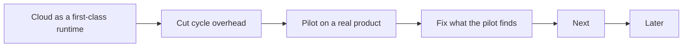

# Roadmap

What comes next for agentic-sdlc, in order. This repo does not run its own factory, so this file
is its backlog. A finished item leaves this file; the git log holds it.

## Now

The factory serves any project. A Claude cloud scheduled task on a subscription is a first-class
runtime, not a fallback. Facts from the Claude Code docs (cloud environments, scheduled tasks):
the GitHub proxy rejects every GraphQL call, whatever the token, so `gh pr`, `gh issue` and
Projects v2 fail; repo plugins do not load; a foreground command stops at 10 minutes; scheduled
runs use the same subscription limits as interactive work; claude.ai connectors and network
secrets are available.

| Item | Why | Done when |
|---|---|---|
| GitHub adapters on REST only | `src/forge/github.ts` and `src/board/github.ts` call `gh pr` and `gh issue` (GraphQL) about 15 times. | No adapter call uses GraphQL, except Projects v2 field writes. |
| Draft and auto-merge without GraphQL | "Ready for review", "draft" and auto-merge exist only in GraphQL. | Draft is a label; the review run merges with `PUT /pulls/{n}/merge` after green checks; contract §3.2 says so. |
| A board a cloud run can reach on GitHub | Projects v2 is GraphQL only. | A `github-issues` board (labels for Status, Size, Priority, Lane, Shipped), or the GitHub MCP connector through `board.mcp`, whichever the cloud probe proves. Jira and Linear stay: their hosts are outside the GitHub proxy; their tokens go in network secrets. |
| Skills in a cloud session | Plugins from `.claude/settings.json` do not load; `templates/runner/claude-routine.md` says to enable one. | `init --harness claude` can write the skills to `.claude/skills/`; the routine template names that path. |
| Long verify out of the agent run | A cloud foreground command stops at 10 minutes. | The routine runs `commands.fast_check`; `Required` runs `commands.verify` in CI; the template says so. |
| `doctor` names unenforced gates | On a private GitHub Free repo, rulesets and branch protection return 403, so no gate blocks a merge. | `doctor` warns when the trunk has no enforced ruleset. |
| Cut cycle overhead | An idle cycle still writes a full heartbeat and starts a review session (about 12k tokens); every subagent re-loads the 3.7k-token navigator; the heartbeat holds 17 measures no code reads. | Idle exit; the review fires only for an unreviewed CR; heartbeat `at`, `factory`, `runs`, `errors`; a 1k contract file for step skills; Sonnet as the routine model, Opus for `shape`. |
| Learning loop behind one switch | A subscription reports no cost per run, so the USD fields are always empty. | Learning is off unless enabled; the USD cost fields are gone; the bench stays for API-billed setups. |
| Delete what no runtime test covers | Grok and Antigravity harness files, `mcp --http`, the `tuning` class with no bench. | Each harness the docs list has a test, or it is deleted. |
| Pilot on a real product repo | 179 tests, no run against a real product. | Three scheduled cloud runs in a row write a heartbeat with no `errors`, and one ticket goes from Ready to Done with no hand fix. |

## Next

| Item | Why |
|---|---|
| Owners as lists; optional operator, security and compliance owners | Teams have more than one owner per role. |
| `product.slo` and DORA measures | Error budget pauses feature work; P0 counted as change failure; rework rate. |
| Pin CI actions by SHA; fail when `AGENTIC_SDLC_VERSION` is unset | Mutable refs in gate templates. |

## Later

| Item | Why |
|---|---|
| Scorers for shape quality and triage accuracy | `improve-factory` has no evidence for those two skills. |
| Move the common contract to `skills/sdlc/references/contract.md`; fold `verify-ux` into `review-pr` | Shorter skills, one home per rule. |
| OpenTelemetry GenAI attributes and CDEvents on factory and deploy records | Standard telemetry for agent runs and deploys. |
| `signal-on-red` through a `forge run <id>` verb | Today it searches a window of 30 runs. |
