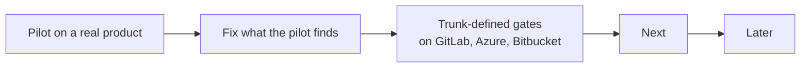

# Roadmap

What comes next for agentic-sdlc, in order. This repo does not run its own factory, so this file
is its backlog. A finished item moves to the CHANGELOG and leaves this file.

## Now

| Item | Why | Done when |
|---|---|---|
| Stress-test fixes, in the report's order | The [stress test](audits/2026-11-13-stress-test.md) found 12 P1 breaks; most come from several writers on one board field. | Every P1 break is fixed or rejected with a reason, and the feature files match. |
| Pilot on a real product repo | v2 has 158 passing tests but has never run against a real product. | Three scheduled cycles in a row write a heartbeat with no `errors`, and a ticket goes from Backlog to Shipped. |
| Default binding passes `validate` with no warning | A fresh `init` warns: `learning.budget_usd_per_week > 0 but agent_command is unset`. | `init` then `validate` prints no warning. |
| GitHub board scoped to its repo | The adapter reads every Project item and keys tickets by issue number, so two repos in one Project collide. | `board list` returns only items whose issue is in `board.options.repo`, with a test. |
| Trunk-defined gates on GitLab, Azure and Bitbucket | The CR's own pipeline file can read the gate secrets. `doctor` only warns. | The secret-holding gates run from a pipeline the CR cannot change, or `doctor` fails for that forge. |

### Skill text to make exact

Found while writing the [behaviour specs](behaviour/README.md). Each line is a gap or a conflict
between two sources. Fix each in the skill, then update its feature file.

| Where | Gap |
|---|---|
| `skills/implement-spec/SKILL.md` step 1 | "Goes back to shape" names no Status; routing sends only Backlog tickets to shape. |
| `skills/review-pr/SKILL.md` severity | A deviation with an updated spec comment is neither a finding nor a Nit. |
| `skills/review-pr/SKILL.md` steps 2, 10 | A check missing past `stall_minutes` has two rules (escalate Access, or send back); draft and ready CRs are not split. |
| `skills/review-pr/SKILL.md` step 2 | Whether the report is posted while a criterion is PENDING. |
| `skills/review-pr/SKILL.md` with `review_runtime: same` | Which identity posts the review status. |
| `skills/escalate-to-human/SKILL.md` step 1 | Whether an owner reply must name P0 to settle the P0 trigger. |
| `skills/escalate-to-human/SKILL.md` step 3 | Where the `proceed` line goes for a factory CR with no ticket. |
| `skills/shape/SKILL.md` initiative stop | "No comment" conflicts with the common contract's closing comment. |
| `skills/shape/SKILL.md` checklist | Says `linkage` fails on an unticked box; `gates.md` defines no checkbox rule. |
| `skills/shape/SKILL.md` split | Whether the original keeps its Priority after it becomes an initiative. |
| `skills/backlog-grooming/SKILL.md` step 2 | Closes a parent "as completed"; `board.md` says Done with the lowest Shipped; `statuses.md` says only `board-sync` moves to Done. |
| `skills/sdlc/references/board.md`, `skills/triage-signal/SKILL.md` | Neither names who writes the P0 field. |
| `skills/sdlc/SKILL.md` cycle rules | After `time_budget_minutes`, whether judge and learn still run. |
| `skills/sdlc/SKILL.md` cycle rules | "When it has none" has no clear subject; `statuses.md` says the heartbeat ticket is not a ticket, yet it can hold. |
| `skills/triage-signal/SKILL.md` step 5 | Links and evidence move only for a duplicate, not for already fixed or noise. |
| `skills/verify-ux/SKILL.md` evidence | No rule for a comment posted by an account outside `owners.bots`. |
| `skills/sdlc/references/gates.md`, contract §3.4 | `branch-names` also allows `dependabot/` and `renovate/` (`src/gates.ts`); the docs do not say so. |
| `skills/sdlc/references/gates.md` shipped | A failed deploy with one environment returns tickets to Not shipped; the doc names only the environment before the last. |
| Contract §6 | `learning.lastProposal` and `learning.benchBaseline`, read by `improve-factory`, are not in the contract. |
| `hooks/guard.mjs`, pre-push hook | No test for a trunk checkout push with at most one argument, input that is not JSON, or `--stdin-prepush`. |

## Next

| Item | Why |
|---|---|
| `product.delivery: release-line \| continuous` | A product with continuous delivery has no release line today. |
| Owners as lists; optional operator, security and compliance owners | Teams have more than one owner per role. |
| Release evidence: SBOM, SLSA provenance, signatures | Release ready check for supply chain (see the [operating baseline](operating-baseline.md#operate-in-q4-2026-and-2027-not-enforced-yet)). |
| `product.compliance` with reporting clocks | EU CRA early warning in 24 hours, notification in 72 hours, read by `triage-signal`. |
| `product.slo` and DORA measures | Error budget pauses feature work; P0 counted as change failure; rework rate. |
| Pin CI actions by SHA; fail when `AGENTIC_SDLC_VERSION` is unset | Mutable refs in gate templates. |
| GitHub board `get` and `move` through the issue's project item | Today they read the whole Project, capped at 1000 items. |
| `forge.list` resolves each Done ticket's CR | Today `shipped` reads a window of 100 merged CRs. |

## Later

| Item | Why |
|---|---|
| Scorers for shape quality and triage accuracy | `improve-factory` has no evidence for those two skills. |
| Move the common contract to `skills/sdlc/references/contract.md`; fold `verify-ux` into `review-pr` | Shorter skills, one home per rule. |
| OpenTelemetry GenAI attributes and CDEvents on factory and deploy records | Standard telemetry for agent runs and deploys. |
| `signal-on-red` through a `forge run <id>` verb | Today it searches a window of 30 runs. |
