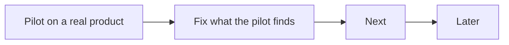

# Roadmap

What comes next for agentic-sdlc, in order. This repo does not run its own factory, so this file
is its backlog. A finished item moves to the CHANGELOG and leaves this file.

## Now

| Item | Why | Done when |
|---|---|---|
| Pilot on a real product repo | v2 has 179 passing tests but has never run against a real product. | Three scheduled cycles in a row write a heartbeat with no `errors`, and a ticket goes from Backlog to Shipped. |

### WalletMate pilot plan

Agreed on 2026-11-14 with the WalletMate sessions and the owner.

- **When:** after WalletMate's M0 is proven locally (the owner's rule: no CI billing before that; M0 is due 2026-12-31). A self-hosted runner bills no minutes, so the owner may choose to start earlier. Install at a quiet point: no open PR, In review empty, Ready intake paused.
- **Runners:** the cycle and the gates run in GitHub Actions on two self-hosted runners on the owner's PC (`AGENTIC_RUNS_ON` for code, `AGENTIC_RUNS_ON_TRUSTED` for secrets), because a cloud routine cannot reach Project 1. One code runner keeps one Playwright run at a time.
- **Merge rule:** v2's risk classes replace "the owner merges every PR". `forge.human_approval: full-lane`: Fast-lane CRs auto-merge; Full-lane CRs (Size above S, or `lane_areas` custody, redaction and sync, or `walletmate-3.0-marketing/app/legal/**`) wait for the owner's approval; factory CRs wait for `owners.factory`.
- **Skills:** from the plugin (`--harness claude`); the repo keeps only the binding, workflows, rulesets and hook. Retire `.agents/skills`. Move `.agents/rules/test-pyramid.md` and `review-checklist.md` to `paths.test_standard` and `paths.review_checklist`.
- **Binding values to carry:** `commands.verify: pnpm run verify` (about 22 minutes, Docker, the Playwright lock), the light verify for `.agents`, `.github`, wiki and `*.md` as `paths.no_proof`, 18 locales and the screenshot rule in the review checklist, environments staging and production with `test:smoke` and `test:live`.
- **First tickets:** #2080 (Fast lane, test only), then #1862 (marketing, no other origins), then one Size S design child of #1420. Avoid #1767, #1637 and #1518 (Full lane, high risk) for the pilot.

## Next

| Item | Why |
|---|---|
| Owners as lists; optional operator, security and compliance owners | Teams have more than one owner per role. |
| `product.slo` and DORA measures | Error budget pauses feature work; P0 counted as change failure; rework rate. |
| Pin CI actions by SHA; fail when `AGENTIC_SDLC_VERSION` is unset | Mutable refs in gate templates. |

## Later

| Item | Why |
|---|---|
| Scorers for shape quality and triage accuracy | `improve-factory` has no evidence for those two skills. |
| Move the common contract to `skills/sdlc/references/contract.md`; fold `verify-ux` into `review-pr` | Shorter skills, one home per rule. |
| OpenTelemetry GenAI attributes and CDEvents on factory and deploy records | Standard telemetry for agent runs and deploys. |
| `signal-on-red` through a `forge run <id>` verb | Today it searches a window of 30 runs. |
