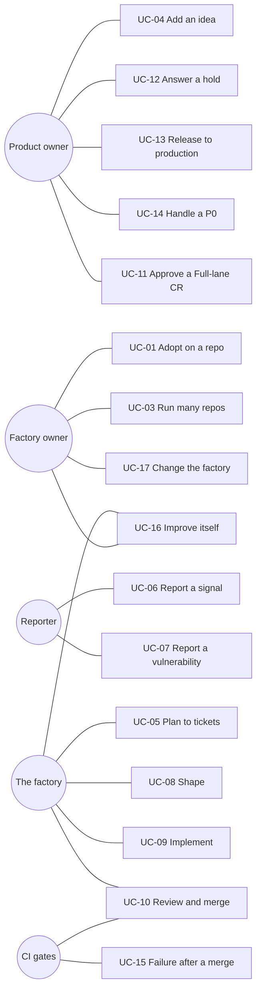

# Use cases

Who uses the factory, for what, and which skill or gate acts. The skills hold the rules; the
[behaviour specs](behaviour/README.md) state what each use case must do, scenario by scenario. The
diagrams are in [flows](architecture/flows.md).

## Actors

| Actor | Who | Acts through |
|---|---|---|
| Product owner | `owners.product` | Board: Ideas, Priority, P0, trusted comments. Forge: Full-lane and production approvals. |
| Factory owner | `owners.factory` | The binding, skills, gates. Approves `guardrail` factory CRs. |
| Engineer | Anyone with push access | A CR like any other; the same gates apply. |
| Reporter | A user, a monitor, CI, a scanner, a security researcher | A Signal (`signal:<stream>`) or `SECURITY.md`. |
| The factory | The scheduled cycle and review runs, as `owners.bots` | Skills, through `agentic-sdlc board\|forge\|vcs`. |
| CI | The forge's pipelines | The gates. No agent can skip a gate. |

## Catalogue

| ID | Use case | Trigger | Main flow | Outcome | Spec |
|---|---|---|---|---|---|
| UC-01 | Adopt on a repo | A team wants the factory | [Adoption](adoption.md): `init`, binding, `doctor`, one attended cycle, a scheduler | `doctor` ok; one heartbeat | [install-and-binding](behaviour/install-and-binding.feature) |
| UC-02 | Move from a hand-made process | A repo has its own skills or scripts | Keep the repo's docs; put its values in the binding; delete its copies of the skills | One skill pack, one binding | [install-and-binding](behaviour/install-and-binding.feature) |
| UC-03 | Run many repos | An organisation has several products | One binding per repo, one pinned version per repo, a shared factory owner | Each repo upgrades on its own tag | [adoption](adoption.md#many-repos) |
| UC-04 | Add an idea | The Product owner has a thought | Write it in Ideas; move it to Backlog when wanted | `backlog-grooming` writes outcome and metric, or asks one question | [backlog-grooming](behaviour/backlog-grooming.feature) |
| UC-05 | Turn a plan into tickets | A plan or a conversation exists | `backlog-grooming` dedupes, groups, prioritises, creates | Prioritised Backlog tickets, initiatives with children | [backlog-grooming](behaviour/backlog-grooming.feature) |
| UC-06 | Report a signal | An alert, feedback, a red run, a deploy failure, a scanner finding | A Signal with `signal:<stream>`; `triage-signal` decides | Backlog, Ideas or Cancelled, with a reason | [triage-signal](behaviour/triage-signal.feature) |
| UC-07 | Report a vulnerability | A report through `paths.security_policy` | `triage-signal` acknowledges, keeps detail out of public tickets | An accepted security ticket first in the queue | [triage-signal](behaviour/triage-signal.feature) |
| UC-08 | Shape a ticket | Backlog with a Priority | `shape` writes the spec, criteria, Size and Lane; splits big work | Ready, or children in Backlog | [shape](behaviour/shape.feature) |
| UC-09 | Implement a ticket | Ready or In progress | `implement-spec` opens a change line, writes code and proofs, opens a draft CR | In review; rework reads CR comments | [implement-spec](behaviour/implement-spec.feature) |
| UC-10 | Review and merge | A draft CR | `review-pr` in the review run; gates; auto-merge | Done, Not shipped; or sent back with findings | [review-pr](behaviour/review-pr.feature), [gates](behaviour/README.md#files) |
| UC-11 | Approve a Full-lane CR | Lane Full, or `forge.human_approval: always` | A human approves the head; the approval gate passes | Merge | [review-pr](behaviour/review-pr.feature) |
| UC-12 | Answer a hold | A `### Needs human` comment | The owner replies in a trusted comment; the cycle removes the label (the owner may also remove it) | The next cycle resumes at the same Status | [escalate-to-human](behaviour/escalate-to-human.feature) |
| UC-13 | Release to production | A release request ticket | `release` proposes; the owner says go; the cut; the owner approves the last environment (on GitHub, the release workflow run) | Shipped On production, tag created | [release](behaviour/release.feature) |
| UC-14 | Handle a P0 | The Product owner sets P0 | Hold until an owner reply; the fix ships first; `release` starts on its own | Mitigated, released, postmortem ticket | [triage-signal](behaviour/triage-signal.feature), [release](behaviour/release.feature) |
| UC-15 | Failure after a merge | Red CI on the trunk or a release line, or a failed deploy | `signal-on-red` opens a Signal for red CI; `gate shipped` opens one per failed deploy, with its env label; a new ticket carries a regression case | The Done ticket stays Done | [gates](behaviour/README.md#files) |
| UC-16 | The factory improves itself | `ledger summary` shows `learning.due` | `judge-run` grades; `improve-factory` proposes one change with bench proof | One factory CR | [self-improvement](behaviour/self-improvement.feature) |
| UC-17 | Change the factory by hand | The Factory owner edits a skill or the binding | A factory CR; `guardrail` needs the Factory owner's approval | New factory version | [gates](behaviour/README.md#files) |
| UC-18 | Keep the product maintained | Dependency, advisory, end-of-life or expiry scanners | `signal:maintenance` Signals; tech debt only with a stated cost; flag removal tickets | Maintenance work in the normal queue | [triage-signal](behaviour/triage-signal.feature), [backlog-grooming](behaviour/backlog-grooming.feature) |
| UC-19 | Stop an agent from pushing to the trunk | An agent runs `git push` to the trunk or a release line | The push guard and the pre-push hook refuse it | Work goes through a CR | [push-guard](behaviour/push-guard.feature) |

## Use cases by team shape

The same skills serve every shape; only binding values change. The values are in the
[operating baseline](operating-baseline.md#team-shapes).

| Use case | Solo | Small team | Enterprise | Agent-heavy | Non-developer owner |
|---|---|---|---|---|---|
| UC-04 Add an idea | the developer | the lead | product role | product role | the owner, on the board only |
| UC-11 Approve a Full-lane CR | the developer approves the bot's CR | a second engineer | a human on every CR | a human on every CR | the technical steward |
| UC-12 Answer a hold | the developer | the lead or the steward | the named owner | the named owner | the owner for product; the steward for access |
| UC-13 Release to production | the developer | the lead | product role, after change approval | product role | the owner, after the steward's check |
| UC-17 Change the factory | the developer | the second engineer | the platform team | the platform team | the steward |
