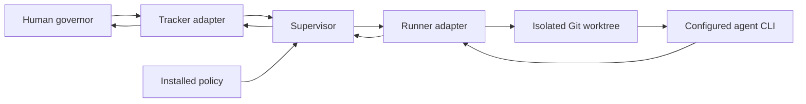
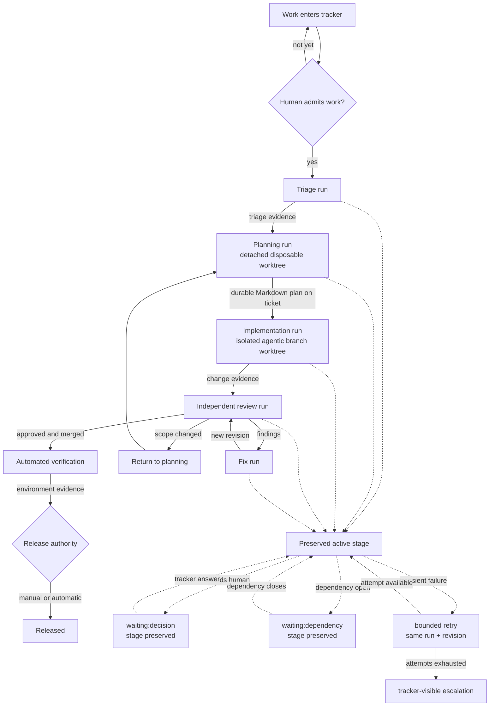
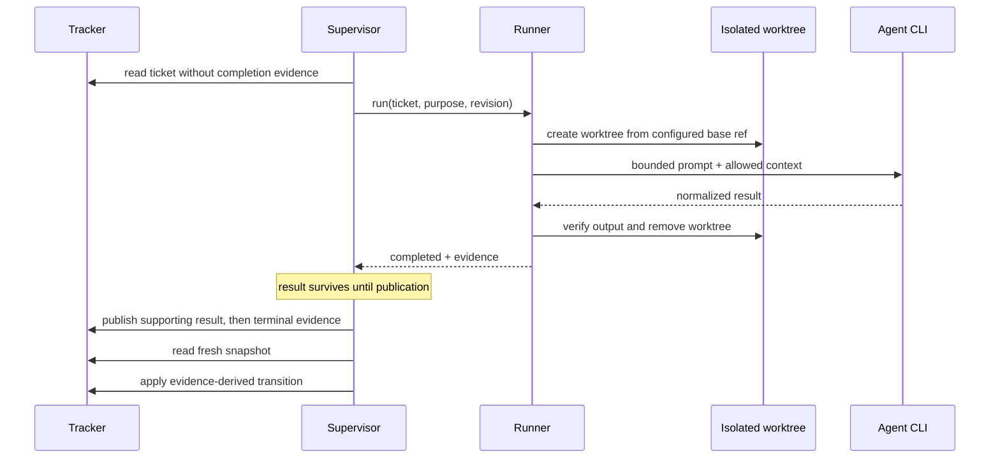
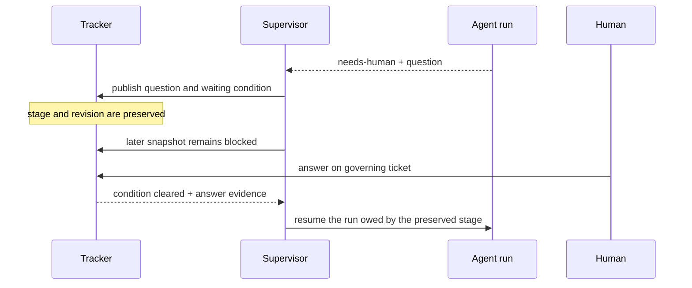
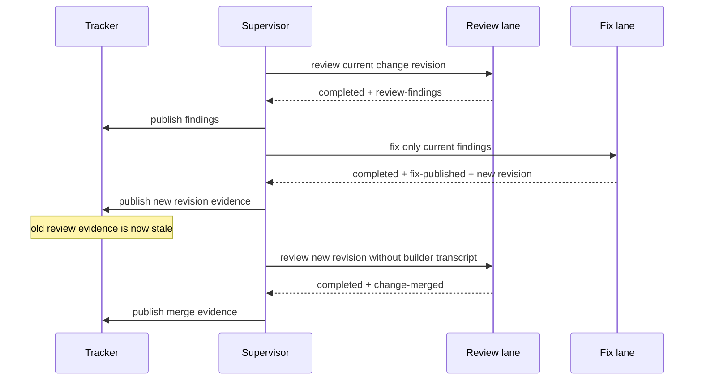
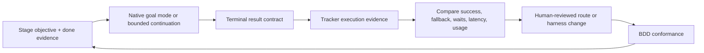
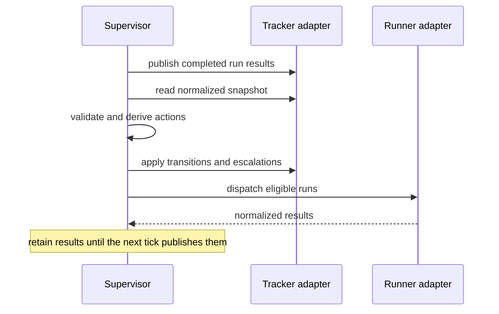

# Agentic SDLC specification

Status: normative, portable contract.

This document defines a small board-driven loop in which software agents do bounded work and a
human governs exceptions. It deliberately excludes tracker APIs, CLI syntax, repository layout,
model names, credentials, deployment providers, and project vocabulary.

## 1. Sources of truth

| Concern | Authority |
|---|---|
| Portable process | This specification |
| Project choices | Installed policy |
| Work and delivery facts | Tracker |
| Executable behavior | Tool engine & SDK, proven by `assets/process.feature` |
| Local diagnostics | Disposable runtime directory |

An authority may link to another authority but must not copy it. Tracker facts win after a
restart; local runtime state never advances work.

## 2. System boundary



The system has four components:

1. **Policy** configures one project.
2. **Tracker adapter** translates durable tracker facts to and from the normalized contract.
3. **Supervisor** derives transitions and dispatches bounded runs.
4. **Runner adapter** selects a configured model profile, invokes its CLI, and returns a
   normalized result.

Adapters may target GitHub, Jira, a local file, Codex, Gemini, or another system without changing
the supervisor.

## 3. Target end-to-end lifecycle

The installed policy maps project-specific stage names onto this lifecycle. A project may omit
an optional step, but it must preserve the evidence, waiting, review, and escalation semantics.



`Active` means the ticket's preserved stage and revision; it is not another tracker stage.

### 3.1 Normal work



Example: a planning stage lacks `plan-ready`, so the configured planning lane runs. The next
tick publishes `plan-ready`, reads a new tracker revision, and advances the ticket. It does not
also start implementation from the stale pre-transition snapshot.

### 3.2 User input



Example: implementation discovers a product choice the policy cannot answer. The ticket remains
in implementation, shows the smallest concrete question, and dispatches nothing until the
answer is durable in the tracker.

### 3.3 Failed review, fix, and re-review



Example: review finds a weakened authorization test. The fix run receives the change and current
finding, not the builder transcript. Its new revision invalidates the old finding and approval,
so review runs again. Review-round exhaustion escalates instead of merging.

### 3.4 Other required use cases

| Use case | Observable behavior |
|---|---|
| Dependency wait | The ticket keeps its stage, dispatch is blocked, and closing the dependency resumes the run owed by that stage. |
| Work split | Parent/child or blocker relationships stay tracker-native; the parent advances only when the adapter exposes current completion evidence. |
| Requirement feedback during review | The tracker exposes `replan-requested`; the configured transition returns the ticket to planning and obsolete plan/change evidence is no longer current. |
| Transient failure | The same run and revision retry after configured backoff while attempts remain. |
| Permanent or exhausted failure | One escalation is published on the governing ticket and no further run is claimed. |
| Restart | A fresh snapshot and current tracker evidence reproduce the same decision without replaying completed work. |
| Release | CI or a human publishes environment evidence; the supervisor derives the configured release transition and never invents deployment success. |

### 3.5 Model management

The process names semantic lanes; the installed policy routes each lane to one primary model
profile and zero or more ordered fallbacks. A profile owns provider-specific CLI arguments,
pinned model identity, explicit reasoning effort, prompt transport, permissions, and
continuation arguments.

| Lane purpose | Why its primary is chosen |
|---|---|
| Triage | Fast, economical classification and dependency discovery; no repository edits. |
| Planning | Strongest available reasoning for scope, architecture, risks, and acceptance scenarios. |
| Implementation/fix | Reliable tool use, repository editing, verification, and throughput. |
| Review | Independent judgment and actionable findings; preferably a different model family from the builder. |

Fallbacks are explicit availability insurance, not voting or silent quality downgrade:

1. Try the primary profile.
2. Try ordered fallbacks only when a profile cannot start, crashes, times out, returns malformed
   output, or exhausts goal continuations without a terminal result.
3. Do not fall back after a valid `completed`, `failed`, or `needs-human` result. Those are task
   outcomes handled by the supervisor.
4. Every fallback must satisfy the same permissions, context boundary, and result contract.
5. Record the selected profile, model, effort, fallback position, and continuation count with
   the run result so maintainers can tune policy from evidence.

Model/provider names, versions, effort, and routing rationale belong in policy. Profiles pin
exact identifiers rather than moving aliases when the CLI exposes versioned identifiers. The
portable process never assumes that a particular vendor is best, available, or acceptable for
every project.

### 3.6 Stage-scoped goal mode

Every dispatched run is one bounded goal: complete the configured purpose for one ticket at one
source revision and return one terminal result contract. The runner derives the objective from
the run, current context, allowed evidence, and completion evidence.

| Run | Goal improves the harness by keeping work focused until… |
|---|---|
| Triage | eligibility, dependencies, and real human decisions are explicit. |
| Plan | a durable implementation plan and acceptance scenarios are complete and available to execution. |
| Execute | the change, verification, artifacts, and new revision are reported. |
| Review | the current revision has an independent verdict with actionable findings. |
| Fix | current findings are addressed and a new revision is reported for re-review. |

Every stage runs in an isolated Git worktree, never in the human checkout. Planning uses a
detached worktree at the configured base ref and removes it after publishing its Markdown plan
to the governing ticket. Implementation uses a unique `agentic/` branch worktree from that base
ref, commits, pushes, and opens a draft pull request before reporting completion.

When the selected CLI exposes native goal mode, the prompt directs it to use that mode for the
exact stage objective. The portable runner also provides a bounded continuation safety net:
after a clean exit without a terminal result, it resumes the same CLI session when supported,
or continues in the same workspace otherwise. One supervisor claim spans every continuation;
continuations are not retries, new tickets, or new tracker stages.

Goal mode ends only with a valid terminal result, its configured continuation limit, or a run
timeout shared by the primary, every continuation, and every fallback. Exhaustion may activate
the next approved model fallback. It never invents evidence,
changes tracker truth, or self-modifies routing policy. Recorded outcome, model, effort,
continuation, latency, and usage data are the feedback loop for improving each lane's model,
prompt, limits, and acceptance harness.



Tune one lane at a time. Prefer terminal-contract rate and correct evidence over raw token or
turn count; a cheap model that repeatedly needs fallback is not cheaper. Any routing, prompt,
or continuation change is a policy/process change and must pass the relevant BDD scenarios
before dispatch.

## 4. Domain model

- **Stage** says how far a ticket has progressed.
- **Condition** says why a ticket cannot move. It never changes the stage.
- **Evidence** is a durable fact proving an outcome for the current revision.
- **Run** is one bounded agent invocation with one purpose.
- **Transition** changes a stage because its configured evidence exists.
- **Escalation** is a tracker-visible request for human action.

Stages and conditions are separate axes. A decision requested during review blocks review and
later resumes review; it does not move the ticket to a waiting stage.

Evidence is revision-aware. An adapter must not expose evidence produced for an obsolete plan,
commit, change, or deployment as current evidence.

## 5. Normalized contracts

The tracker adapter returns:

```ts
type Ticket = {
  id: string
  stage: string
  conditions: string[]
  evidence: string[]
  revision: string
  priority?: number
  dependencies?: string[]
  context?: string
  eligible?: boolean
}

type Snapshot = {
  revision: string
  tickets: Ticket[]
}
```

The supervisor emits only:

```ts
type Action =
  | { type: "transition"; ticket: string; from: string; to: string; evidence: string }
  | { type: "dispatch"; ticket: string; run: string; lane: string; revision: string }
  | { type: "escalate"; ticket: string; reason: string }
```

The runner returns:

```ts
type RunResult = {
  ticket: string
  run: string
  revision: string
  nextRevision?: string
  outcome: "completed" | "failed" | "needs-human"
  retryable?: boolean
  evidence?: string[]
  summary: string
  plan?: string // required by a work rule that sets requiresPlan and produces its completion evidence
  pullRequest?: number // required by a work rule that sets requiresPullRequest
  artifacts?: string[]
  changes?: string[]
  usage?: { inputTokens?: number; outputTokens?: number; cost?: number }
  execution?: {
    route: string
    profile: string
    model?: string
    effort?: string
    fallbackIndex: number
    goalContinuations: number
    durationMs: number
  }
}
```

Tracker adapters must not expose `plan-ready` as current evidence unless the matching completed
result contains the durable `plan` content. The adapter makes that content available in the
following execution context; a local path recorded in `artifacts` is not a durable plan.

Unknown fields may be retained by an adapter but are ignored by the core. Invalid or mismatched
ticket, run, or revision values fail closed.

`revision` identifies the tracker state dispatched to the run and never changes inside that
result. `nextRevision` identifies a new state published by the run. Git-backed adapters use the
full commit SHA for an open or merged change, so a CLI can report `git rev-parse HEAD`; before a
change exists, an adapter may use a stable digest of the ticket's planning content.

## 6. Policy contract

The installed JSON policy contains:

- `tracker.adapter` and tracker options;
- `runner.adapter`, semantic routes, and named model profiles;
- each route's rationale, primary profile, and ordered fallbacks;
- bounded goal-mode continuation settings;
- ordered `process.stages`;
- `process.transitions`, each with one required evidence token;
- ordered `process.work` rules, each mapping a stage to a run, lane, evidence predicates,
  completion evidence, and evidence it may produce;
- blocking `process.conditions`;
- bounded `limits`;
- `rules.protectedPaths`, context sources, and project-rules files;
- a disposable runtime directory;
- an optional runtime dispatch kill switch, which never changes tracker truth.

The policy is data, not executable prose. It must not contain shell fragments, persona prompts,
tracker API algorithms, or duplicated sections of this specification.

Validation rejects:

- duplicate stage, transition, work-rule, condition, or lane identifiers;
- transitions that reference unknown stages;
- work rules that reference unknown stages or lanes;
- routes that reference unknown or duplicate profiles;
- missing routing rationale or invalid goal continuation limits;
- work rules without a unique id, completion evidence, or allowed `produces` list;
- non-positive limits;
- adapter paths outside the project or skill package;
- a runtime directory outside the project;
- missing project-rules files.

## 7. Derivation

For each ticket:

1. Reject an unknown stage or malformed normalized fact.
2. Derive a configured transition when its evidence exists.
3. Block dispatch when any configured blocking condition exists.
4. Otherwise select the first work rule for the stage whose required evidence is present,
   forbidden evidence is absent, and completion evidence is absent.
5. Respect dependencies, concurrency, retry delay, and attempt limits.
6. Escalate exhausted attempts or a `needs-human` result on the ticket.

At most one transition and one run claim may be active for a ticket. A transition is applied
before considering work in the new stage on a later snapshot.

## 8. Tick protocol



This ordering is mandatory. Publishing completed results first makes a crash recoverable and
prevents a stale snapshot from redispatching finished work.

A one-shot tick and a continuous loop execute the same protocol. The loop adds only an interval
and graceful shutdown. A read-only tick stops after derivation: it may read the tracker and
report actions, but must not publish, transition, escalate, persist runtime state, or dispatch.

## 9. Run isolation

Each run receives only:

- its ticket and run purpose;
- project rules and configured context;
- artifacts explicitly allowed for that run;
- the result contract.

A reviewer does not receive the builder transcript. A fixer receives current findings and the
change, not the builder's hidden context. Credentials not needed by the configured capability
must not enter the child environment.

The runner treats the CLI as a process boundary. Provider-specific streaming formats, tool
protocols, or model APIs belong in runner adapters, never in the supervisor.

## 10. Publication and safety

The tracker adapter publishes normalized results as durable evidence. It must:

- bind evidence to the ticket and current revision;
- publish supporting detail before terminal evidence;
- make duplicate publication idempotent;
- refuse evidence outside the run's configured capability;
- make human waits visible on the governing ticket.

When publication cannot complete, the supervisor retains the result for a later idempotent retry
and reports the affected ticket, run, and adapter failure reason. It must not reduce an
unexpected publication failure to an un-actionable generic error.

Protected paths are enforced before publication. A run that touches a protected path fails
without retry unless the policy explicitly grants that run the capability.

Retries are bounded. Transient failures may retry after configured backoff. Contract,
capability, protected-path, and invalid-revision failures do not retry.

## 11. Human governance

Humans own admission, unresolved product choices, exceptions, and release authority configured
as manual. The supervisor owns mechanical derivation only.

An escalation states:

- what is blocked;
- the evidence observed;
- the smallest decision or action needed;
- the preserved resume stage.

Resolving an escalation changes tracker facts. No local acknowledgement may unblock a ticket.

## 12. Restart and reproducibility

After any restart, the supervisor rebuilds its decisions from the installed policy and a fresh
tracker snapshot. It may retain only operational hints such as retry timestamps or unpublished
completed results.

Deleting the runtime directory may cause a safe re-read or re-publication attempt, but must not:

- lose durable evidence;
- repeat a completed run;
- reset a durable review or retry limit;
- change a ticket stage;
- erase a human wait.

The same policy, adapter versions, and normalized snapshot must produce the same ordered actions.

## 13. Executable examples

`assets/process.feature` is the sole BDD scenario set. It covers installation, the lifecycle,
and exceptional flows above through public behavior.

## 14. Conformance

An implementation conforms when:

1. policy validation passes;
2. the executable BDD scenarios pass through public interfaces;
3. a repeated unchanged tick is idempotent;
4. a runtime-deletion restart passes;
5. tracker and CLI adapters can be replaced without core changes;
6. project rules contain only the installer-owned concise pointer;
7. no persona, playbook, README, prompt, or generated runtime file acts as another process
   authority.

Implementation file names, class names, internal events, cache layout, tracker queries, CLI
arguments, model choice, and UI rendering are intentionally outside this contract.
